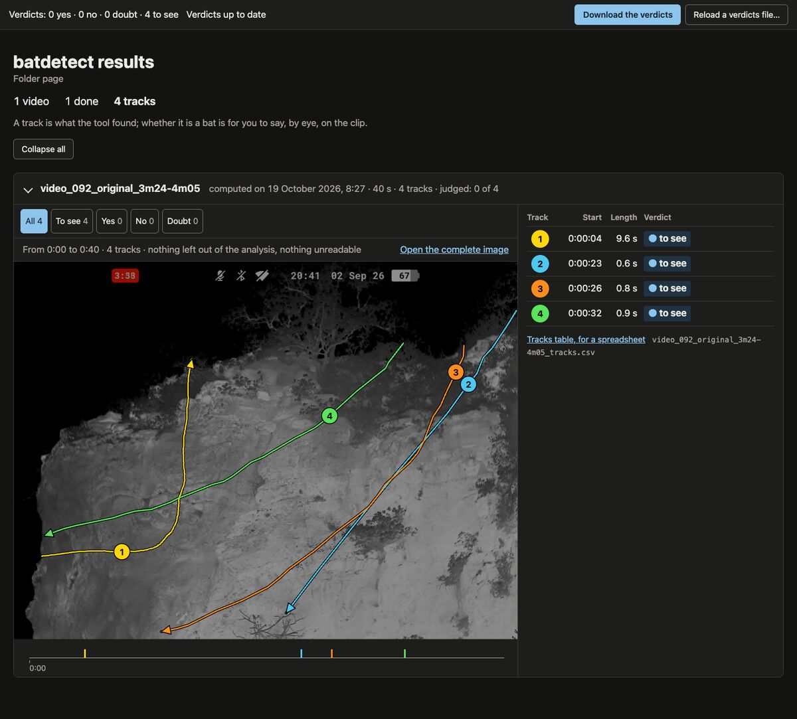

# batdetect

A tool to find the bats flying through the videos of your thermal binoculars.



## Why

I saw my girlfriend, a naturalist, use dvr-scan to look for bats in the videos of her thermal binoculars.
It was super slow and it didn't work well (not its fault: it's made for security cameras, not for bats).
Then she had to watch every clip it cut out and try to see what was moving.

`batdetect` was made to do the watching for her <3 I hope you'll also find the tool usefull.

On my Mac (M1 Max), a 5-minute video takes about 20 seconds.

## How does it work

You will copy the videos of an evening from the binoculars to your computer.
`batdetect` will follow everything that moves in them, and each trajectory becomes a track.
For each track, it will cut a short clip and draw the track on a summary image of the scene.
You will watch the clips and decide which tracks are bats: if you filmed bats they probably are but I already had a small insect walking on top of my sensor (that was a very slow bat).

There's no LLM (nor any other kind of AI) looking at your images: it's just maths, a few clever tricks and hours of juggling with parameters.
Everything runs on your computer, even without internet, and your videos never leave it.
Want to learn more: [how the detection works](docs/10-logique-de-detection.md) (in French).

## Installation

On a Mac with Apple silicon and macOS 14 or newer, with [Homebrew](https://brew.sh):

```bash
brew install zaratan/bat-tools/batdetect
```

On Linux (glibc 2.35 or newer) and Windows 10 or newer, on an x86-64-v2 processor or newer, grab `batdetect-linux-x86_64.tar.gz` or `batdetect-windows-x86_64.zip` from the [releases page](https://github.com/zaratan/chiro-dvr/releases/latest).
The first time, Windows SmartScreen may block it: "More info", then "Run anyway".

On a Mac without Homebrew, `batdetect-darwin-arm64.tar.gz` works too, once you've run `xattr -d com.apple.quarantine batdetect` on the unpacked program.

`batdetect doctor` will check, in the current folder, that everything is ready: the video encoder, the free space and the right to write.
`batdetect completion zsh` will tell you how to get Tab completion.

## Usage

Copy the videos of the evening from the binoculars through the USB cable, then:

```bash
batdetect path/to/the/evening
```

Everything goes in `path/to/the/evening/batdetect/`, or wherever you point `-o`.
On a Mac, the results page opens by itself at the end.
`batdetect --help` lists the options and the few settings that change the detection.

`batdetect` speaks French and English, following the language of your system.

Every step in detail, with what you should see: [first evening](docs/premiere-soiree.md) (in French).

## What you get

At the end, the Terminal prints the summary of the evening.
On a Mac, the results page, `batdetect/results.html` (`resultats.html` in French), opens in your browser; on Linux and Windows, open it yourself.
The whole evening is on that one page, with the summary images and the clips, and you note your verdict track by track.

Next to it, each video gets a folder with its name:

- the summary image, with every track drawn over the scene (several images for a long video);
- the table of the tracks, to open in a spreadsheet;
- a clip per track, and a slowed-down, zoomed clip for small or faint tracks.

How to read all of this, judge a clip and note your verdict: [reading the results](docs/lire-les-resultats.md) (in French).

## Limits

`batdetect` doesn't recognise a bat and doesn't count passes.
A track can be another animal or image noise; a pass can be missed, or cut into two tracks.
It is set to prefer one track too many over a missed pass, and its default settings work for all of our evenings so far.
It skips the moments where the binoculars move.

What it sees badly, and what to do about it: [what the tool doesn't see](docs/lire-les-resultats.md#ce-que-loutil-ne-voit-pas) (in French).

## Development

Building, checking and releasing: [CONTRIBUTING.md](CONTRIBUTING.md).
What we learned building it, and why it is set the way it is: [the knowledge base](docs/README.md) (in French).

## License

The code is under the MIT license ([LICENSE](LICENSE)).
It was made using AI to code (they type way faster than I do (and don't sleep)) but there's no AI in the final product.
The published program contains FFmpeg (LGPL 2.1 or later), openh264 (BSD-2), the Roboto font (OFL-1.1) and Rust libraries: [packaging/NOTICE](packaging/NOTICE) describes them, and their license texts are in [packaging/licenses/](packaging/licenses/).
