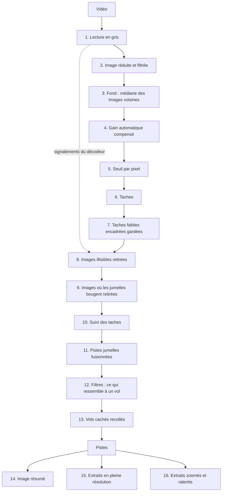

# Méthode globale

Chaque étape est une technique classique de traitement d'image ou de statistique.
Chaque réglage est un nombre fixe écrit dans le code et choisi d'après des mesures.



**L'image**

1. [Lire la vidéo](#lire-la-vidéo) : image par image, la luminosité seule.
2. [Réduire et filtrer l'image](#réduire-et-filtrer-limage) : 960 points de large, un peu adoucie.
3. [Estimer le fond](#estimer-le-fond) : la valeur du milieu des images voisines, endroit par endroit.
4. [Compenser le gain automatique](#compenser-le-gain-automatique) : l'image qui s'éclaircit d'un coup est ramenée au fond.

**Les taches**

5. [Seuiller chaque pixel](#seuiller-chaque-pixel) : un pixel assez différent du fond est retenu.
6. [Regrouper les pixels en taches](#regrouper-les-pixels-en-taches) : les pixels retenus qui se touchent forment une tache.
7. [Garder les taches faibles qui comblent un vol](#garder-les-taches-faibles-qui-comblent-un-vol) : une tache faible entre deux vraies taches reste.
8. [Écarter les images illisibles](#écarter-les-images-illisibles) : les images réparées par le décodeur ne comptent pas.
9. [Écarter les images où les jumelles bougent](#écarter-les-images-où-les-jumelles-bougent) : une image soudain pleine de taches ne compte pas.

**Les pistes**

10. [Relier les taches dans le temps](#relier-les-taches-dans-le-temps) : une piste prend la tache là où son trajet la prédit.
11. [Fusionner les pistes jumelles](#fusionner-les-pistes-jumelles) : deux pistes collées l'une à l'autre n'en font qu'une.
12. [Garder ce qui ressemble à un vol](#garder-ce-qui-ressemble-à-un-vol) : assez de points, assez de chemin, une direction à peu près tenue.
13. [Recoller un vol caché derrière la végétation](#recoller-un-vol-caché-derrière-la-végétation) : la piste qui disparaît puis réapparaît plus loin est recollée.

**Ce que voit la naturaliste**

14. [Dessiner l'image résumé](#dessiner-limage-résumé) : la scène sans animal et toutes les pistes dessus.
15. [Dessiner les extraits](#dessiner-les-extraits) : la vidéo en pleine résolution autour de chaque piste.
16. [Extrait zoomé et ralenti](#extrait-zoomé-et-ralenti) : pour les cibles trop petites ou trop rapides.

Les étapes 1 à 13 lisent la vidéo en petit. Les étapes 15 et 16 la relisent en pleine résolution autour des pistes seulement.
Règle de Manon (9 octobre 2026) : mieux vaut un faux positif facile à écarter qu'un passage manqué.
La piste lente de 3:29 sur la 092 reste donc produite.

Distances et surfaces des réglages, des pistes et du tableau sont en **pixels de la vidéo d'origine**.
Seule la détection travaille plus petit et chaque détection est reconvertie dès sa création.
Ce n'est pas une unité physique : une caméra d'une autre résolution demandera peut-être d'autres valeurs.
Les modules cités sont relatifs à `crates/`.

# Pourquoi pas un outil existant

TLDR : les outils de détection de mouvement visent des objets bien plus gros qu'une chauve-souris lointaine.
Ceux faits pour les chauves-souris sont abandonnés, liés à MATLAB ou payants.

## Explications

**DVR-Scan** 1.8.2.1 détecte le mouvement par soustraction de fond (MOG2) pour la vidéosurveillance.
Le 3 octobre 2026, il ne trouvait aucun événement par défaut sur l'export de la 092 à 1 Mb/s.
Réglé à la main sur une zone sans affichage, il en trouvait 11.
Sa réduction et son filtre du bruit par défaut effacent une cible de quelques pixels.
Son seuil porte sur la part de l'image qui bouge, qu'un point minuscule ne remue presque pas.
Il fusionne les passages proches en un seul événement à une seule boîte.

**ThermalTracker** (PNNL) est libre : sa bibliothèque et sa ligne de commande sont sous une licence de style BSD.
Il demande que le plus chaud soit blanc et dépend d'OpenCV 2.4. Rien n'y a été poussé depuis juin 2018.
**ThruTracker** 2.0 est écrit en MATLAB et publié sous BSD-3. Son README le dit archivé et plus maintenu.
La 3.0, en Python, est maintenue mais vendue sous licence annuelle.
Il soustrait le fond par MOG2 et ne suppose pas de sens au contraste.
**BatCount** ne tourne que sous Windows. Il est en bêta (v1.24), sans licence nommée et sans mise à jour depuis août 2023.
Il sait ignorer les objets plus clairs ou plus sombres que le fond. Sa précision publiée va de 51 à 95 % selon les vidéos.

Aucun de ces outils ne publie de temps de calcul comparable : ils se comparent au comptage humain.
Aucun n'a encore tourné sur nos vidéos (#386).
batdetect est libre (MIT), maintenu, et ne demande aucun environnement propriétaire.
On croit que ces outils servent la science et devraient être open source.

Ce que la littérature justifie dans nos choix :

- En vol, les ailes ne sont qu'à environ 1 °C au-dessus de l'air et ce sont elles qui occupent les pixels à distance.
  Devant la roche qui garde la chaleur du jour, une chauve-souris lointaine est donc plus froide que le fond.
  Sur nos vidéos jusqu'ici, c'est souvent le cas.
  Le contraste peut même s'annuler au croisement thermique. D'où le seuil sur la valeur absolue de l'écart.
- Sabol et Melton (brevet US Army, 2009) prennent aussi la valeur absolue de l'écart au fond.
  Leur prédiction tient compte des images manquées.
- Betke (Boston University, 2008) écarte le seuil fixe : près de la végétation, la cible a l'intensité du fond.
  ThermalTracker (Matzner, 2015) seuille aussi chaque pixel selon son propre bruit.
- ThruTracker lisse et dilate l'image à la taille du plus petit objet, comme notre flou et notre fermeture.
- Aucun de ces outils n'injecte de cibles synthétiques pour se mesurer. Notre banc le fait ([développement](developpement.md)).

# Lire la vidéo

TLDR : l'outil lit la vidéo image par image et ne garde que la luminosité de chaque point. La couleur ne sert qu'aux dessins.

## Explications

FFmpeg 7.1.1 décode la vidéo et il est lié dans le binaire (`media/src/decode.rs`). Seuls les formats `yuv420p` et `yuvj420p` sont acceptés.
La détection ne lit que la luminance Y, convertie en gris de 0 à 255 par une formule en entiers (`engine/src/gray.rs`) :

```
gris = (Y × 4 769 − 81 520) >> 12, borné à 0..255
```

La pente vaut 4 769 / 4 096, environ 255 / 219. Elle étire la plage vidéo de Y (16 à 235) sur 0 à 253.
Une table de référence reste dans le code pour le test qui vérifie la formule niveau par niveau.
Une source marquée en plage pleine (`pc`) passe par la même formule qu'une source `tv`.
La même lecture donne pour chaque image son horodatage `pts`, si c'est une image-clé et les erreurs signalées par le décodeur.
Elles servent à [écarter les images illisibles](#écarter-les-images-illisibles).

# Réduire et filtrer l'image

TLDR : l'image est réduite à 960 points de large puis adoucie à la mesure d'une petite chauve-souris lointaine.
Le grain du capteur s'atténue plus qu'une tache de cette taille.
C'est le peintre qui plisse les yeux : les petits détails se fondent et les formes de la bonne taille restent.

## Explications

**Réduction** à `work_width` pixels de large par **moyenne de surface** (`engine/src/reduction.rs`).
Chaque pixel de travail est la moyenne pondérée des pixels d'origine qu'il couvre, avec un seul arrondi.
La hauteur suit le rapport de l'image. `work_width` va de 16 à la largeur de la vidéo (`types/src/scale.rs`).
Le centre d'un pixel réduit `c` y vaut `(c + 0,5) × échelle − 0,5` en pixels d'origine.
Changer `work_width` ne change donc pas le sens des autres réglages, à l'arrondi près.
À 960 sur 1440, un pixel de travail couvre 1,5 × 1,5 px d'origine, soit 2,25 px².

**Flou gaussien** d'écart-type `target_sigma` en pixels d'origine (`engine/src/blur.rs`, `prepare.rs`).
1,5 px vaut 1 px de travail à 960 sur 1440. Le flou est séparable : une passe sur les lignes puis une sur les colonnes.
Son noyau s'étend à ⌈4σ⌉ pixels de chaque côté avec des poids entiers de somme 4 096 et des bords repliés en miroir.
L'image filtrée garde ses valeurs au 1/64 de niveau. `target_sigma` à 0 désactive le flou.
C'est le **filtre adapté** (*matched filter*) d'une tache gaussienne dans un bruit blanc : le meilleur rapport signal sur bruit pour cette taille.
Il moyenne le bruit d'un pixel avec ses voisins sans écraser une tache de quelques pixels.
Filtrer avant d'estimer le fond mesure fond, résidu et bruit dans le même espace.

**Valeurs**, choisies le 6 octobre 2026 sur sept vidéos 1440×1080 en blanc chaud, toutes du même site.
Des bancs de cibles synthétiques ont tranché entre les candidats (graine 1, sur la 092).
« −30, σ 1,5 » note une classe de cibles de −30 niveaux et de σ = 1,5 px d'origine.

| Réglage | 092 | 089 | 090 | 091 | 125 | 126 | 127 | Calcul (réel / CPU) |
| --- | --- | --- | --- | --- | --- | --- | --- | --- |
| Réglage d'avant (480 px, seuil fixe 25, sans flou) | 14 | 4 | 12 | 23 | 18 | 4 | 0 | 4 / 20 min |
| **Défaut** (960 px, σ 1,5, seuil 12, facteur 8) | 14 | 1 | 20 | 21 | 47 | 12 | 7 | 16 / 45 min |
| Le même à 1440 px | 14 | 1 | 17 | 22 | 48 | 10 | 7 | 38 / 67 min |
| Sans seuil par pixel (trois variantes) | 14 à 18 | 560 à 5 479 | 374 à 4 925 | 394 à 3 974 | 48 à 57 | 11 à 13 | 7 à 13 | |

L'utilisateur a jugé fausses les six pistes du réglage d'avant que le défaut ne sort plus.

- `work_width` = 960 px : la pleine résolution donne presque les mêmes pistes pour 2,4 fois le temps de calcul.
  Le capteur des Symbion DXT50 fait 1280×1024.
  À 480 px, la réduction jetait environ 2,7 fois sa résolution et 30 à 50 % du contraste des cibles de moins de 3 px.
  Sur la 092 à 3:57, la chauve-souris apparaît à l'image 7122 et sa piste à 480 px à 7127.
  Sur ces cinq images, le résidu vaut −42, −31, −30, −71 et −59 en pleine résolution, mais −25, −26, −22, −30 et −30 à 480 px.
  Le flou débruite à la place de la réduction.
- `target_sigma` = 1,5 px, la taille d'une petite chauve-souris lointaine.
  Au banc à 960 px et au seuil 12 sans seuil par pixel, σ 1 laisse passer le bruit (1 408 pistes sur la 092).
  σ 2 perd toutes les petites cibles faibles (0 sur 28 en −30, σ 1,5).
  σ 1,5 en trouve 14 sur 28 et garde les 14 pistes de la 092 : c'était le meilleur réglage qui les gardait.
  À 480 px, il sort 33 pistes sur la 092 : il ne paie qu'avec la résolution.

**Limites.** Une tache plus grande que le filtre est moins rehaussée et une plus petite perd du contraste.

# Estimer le fond

TLDR : pour chaque endroit, l'outil garde la valeur du milieu des images voisines dans le temps. C'est la scène quand rien ne la traverse.
Un photographe prend une dizaine de photos d'un monument envahi de touristes et garde partout ce que la plupart montrent.
Les passants disparaissent et le monument reste.

## Explications

Le fond d'un pixel est la **médiane** de ses valeurs sur une fenêtre de `bg_window_s` centrée sur l'image (`engine/src/window.rs`).
Elle ne prend qu'une image sur `bg_step`. À 30 i/s avec les défauts, la demi-fenêtre fait 15 images et la médiane porte sur 11 valeurs.
La première et la dernière demi-seconde de la vidéo ont une fenêtre tronquée.
Un **réseau de tri** la calcule sur 64 pixels à la fois (`engine/src/network.rs`) : une suite fixe de comparaisons et d'échanges.
Pour 11 valeurs, il compte 28 comparateurs.
Sinon, c'est le tri pair-impair de Batcher élagué aux comparaisons qui fixent la ou les deux valeurs du milieu.
Pour un nombre pair de valeurs, le fond est leur demi-somme. La fenêtre reste en mémoire en entiers de 16 bits.
Au-delà de 4 Gio, elle est refusée avant la lecture.

La médiane est *robuste* : elle ignore l'animal tant qu'il occupe le pixel sur moins de la moitié des valeurs.
Une moyenne garderait sa traînée.
Le traitement n'est pas en direct : la fenêtre regarde l'avenir et suit sans retard les changements lents de lumière.
La différence entre deux images voit chaque objet deux fois et rate les objets lents.
Les mélanges de gaussiennes (MOG2, utilisé par ThruTracker) donnent une sortie binaire sans le signe ni l'amplitude dont la suite a besoin.
Un fond fixe sur toute la vidéo ne suivrait ni la lumière ni le gain.

- `bg_window_s` = 1,0 s.
  Une chauve-souris traverse le champ en 0,3 à 1,3 s (mesuré sur la 092) : elle n'occupe un pixel que quelques images.
  Plus longue, la fenêtre suivrait mal la lumière. Plus courte, elle garderait l'animal dans le fond.
- `bg_step` = 3 : le fond change lentement.
  Un pas qui laisse moins de 3 valeurs n'est plus une médiane et il est refusé (16 et plus à 30 i/s).
  Moins de 7 valeurs désactive le [seuil par pixel](#seuiller-chaque-pixel) (6 et plus à 30 i/s).

**Limite.** Un objet immobile plus d'une demi-seconde entre dans son propre fond et s'efface (#22).

# Compenser le gain automatique

TLDR : les jumelles règlent seules leur luminosité et toute l'image s'éclaircit parfois d'un coup.
L'outil mesure ce changement d'ensemble et le retire avant de chercher ce qui bouge.

## Explications

Une **différence de moyennes** sans réglage (`engine/src/detector.rs`).
L'écart de gain d'une image est sa moyenne filtrée hors de `--osd-region` moins la moyenne des images de la fenêtre du fond.
Il est retiré au résidu de chaque pixel, en entiers jusqu'à une seule division.
C'est le modèle le plus simple : un même décalage pour tous les pixels.

Sur des images fabriquées, un saut de gain de 10 niveaux donne au plus une tache.
Un saut de 20 en donne jusqu'à 10 par image sur 11 images, et de 30 à 40 des centaines. Aucune piste n'en sort, de 10 à 40.
À 30 et 40, le filtre des [images saturées](#écarter-les-images-où-les-jumelles-bougent) ignore 2,6 à 2,8 s autour du saut.

**Limites.** Un changement de contraste étire les valeurs au lieu de les décaler et n'est pas corrigé.
Le fond médian n'est pas corrigé non plus.
Pendant la demi-seconde où la fenêtre mélange l'avant et l'après d'un saut, le résidu en garde une partie.

# Seuiller chaque pixel

TLDR : un pixel est retenu s'il s'écarte assez de la scène sans animal, en plus clair ou en plus sombre.
« Assez » est un minimum, relevé là où l'endroit s'agite dans les instants qui entourent l'image.
Il faut toujours parler assez fort pour être entendu. Près d'une route, il faut crier.

## Explications

Le **résidu** d'un pixel filtré est `r = image − fond − écart de gain` (`engine/src/threshold.rs`).
Le pixel est **fort** si |r| dépasse strictement son seuil :

```
seuil = max(threshold, noise_factor × 1,4826 × MAD)
```

La **MAD** est la médiane des écarts absolus à la médiane, et le facteur 1,4826 en fait un écart-type pour un bruit gaussien.
Elle porte sur les valeurs du pixel dans la fenêtre du fond, chacune corrigée du gain de son image.
Il lui faut au moins 7 valeurs et un `noise_factor` non nul.
Elle n'est calculée que pour les pixels non masqués dont |r| dépasse déjà les trois quarts de `threshold`, les seuls qui peuvent être retenus.
Le seuil d'une image ne dépend que de sa fenêtre.

**Pourquoi la valeur absolue.** L'animal peut être plus chaud ou plus froid que ce qui est derrière lui.
Selon le fond et la palette, il sort donc plus clair ou plus sombre que le fond.
La valeur absolue retient les deux cas, quelle que soit la palette en niveaux de gris.

**Pourquoi un seuil par pixel.** Un seuil unique traite pareil la roche calme et la végétation qui bouge.
Assez bas pour la 092, il laisse passer le bruit des vidéos agitées.
Le bruit de fond de la 089, de la 090 et de la 091 dépasse 12 en quelques points de chaque image.
Sans seuil par pixel, elles sortent des centaines de pistes ([table du 6 octobre](#réduire-et-filtrer-limage)).
La MAD monte à peine pour un animal présent sur une ou deux images de la fenêtre, à la différence de l'écart-type.
Prendre la fenêtre du fond plutôt qu'une moyenne depuis le début garde chaque image dépendante de ses seules voisines.
Le plancher est nécessaire car la MAD sur 11 images est souvent très faible.
Sur l'extrait de test à 480 px, le descendre de 4 à 1 niveau multiplie par 60 les pixels au-dessus de 6 fois le bruit.

- `threshold` = 12 niveaux de gris sur 255 mesurés sur l'image filtrée : c'est le **plancher**, bas pour être sensible sur la roche calme.
- `noise_factor` = 8, et 0 revient au seuil fixe. Au banc, il coûte des petites cibles faibles : 1 sur 28 en −30, σ 1,5 au lieu de 14.
  En chasse, on trouve 456 cibles au lieu de 510.
  Lui seul garde propres la 089, la 090 et la 091 : 1, 20 et 21 pistes au lieu de 560, 374 et 394.
  Elles ont alors une médiane de 0 tache par image au lieu de 3 à 5 taches de bruit en permanence.

**Le seuil bas.** Au-dessus des trois quarts de son seuil (constante `WEAK_RATIO` = 0,75), un pixel est **faible**.
Par défaut, cela fait un plancher de 9 et 6 fois le bruit.
Les pixels faibles ne servent qu'aux [taches faibles encadrées](#garder-les-taches-faibles-qui-comblent-un-vol) et ne changent aucune détection forte.
0,75 est la seule fraction mesurée qui gagne sans abîmer la 092.
À 0,6 et 0,5, les détections faibles détournent le suivi et il coupe des pistes en deux.
La 092 passe alors de 26 positions estimées à 36 et 24 et gagne 4 et 3 pistes nouvelles (17 octobre 2026, #21).
Relever le seuil fort ferait perdre des passages.

**Masque.** Aucun par défaut, pour rester indépendant de la caméra.
Sur l'original de la 092 sans masque, aucune piste ne vient de l'affichage incrusté.
Sur 9 000 images, aucun pixel ne dépasse le seuil plus de 100 fois : 1 dépassement dans la bande du haut et 301 dans celle du bas.
Ce qui reste fixe ne crée aucune détection.
Le compteur d'enregistrement change chaque seconde mais sur place, et `min_travel` rejette ses détections.
`--osd-region x0,y0,x1,y1` sert pour un appareil dont l'affichage bougerait. L'option se répète et prend des fractions de l'image.
Les pixels de la zone ne sont jamais retenus ni comptés dans l'écart de gain (`engine/src/mask.rs`).
La zone est élargie de la portée du flou pour couvrir l'étalement de l'affichage : ⌈4σ⌉ pixels de travail, soit 4 px à 960 sur 1440.
Elle est aussi masquée sur le fond de l'image résumé. Pour les Symbion, `0,0,1,0.07` cache l'heure, la date, la batterie et le chrono.
Sur la 092, il donne les mêmes 14 pistes que sans masque avec les mêmes débuts et les mêmes fins.
Des bandes fixes en haut et en bas (7 et 10 % de l'image) coupaient 5 pistes sur 14.

**Limites.** 11 images estiment mal le bruit d'un pixel : une feuille agitée passe encore parfois.
Une cible faible sur des pixels agités peut être perdue. Sur la 092, le passage réel de 3:42.10 a un pic de 13 à 22 après filtre.
Sur deux de ses six images, il tombe sous un seuil relevé à 22 à 36 et n'a plus assez de détections pour faire une piste.
Le ciel saturé à 0 est aveugle : sa MAD est nulle et aucun résidu sombre n'y est possible. Il couvre 21,2 % des pixels de la 092.
Sous 17 images par seconde avec `bg_step` = 3, seul reste le plancher sur toute la vidéo. Toutes nos vidéos sont à 30 i/s.

# Regrouper les pixels en taches

TLDR : les pixels retenus qui se touchent ou presque forment une tache, comme on entoure d'un trait les gouttes d'une même éclaboussure.
Une tache de taille plausible est un point de passage possible.

## Explications

Une **fermeture morphologique** (`engine/src/closing.rs`) dilate puis érode par un disque de rayon `merge_radius`.
Elle bouche les trous et recolle les fragments proches d'un même animal sans grossir l'objet.
Le rayon se donne en pixels d'origine et s'arrondit au pixel de travail (6 px font 4 px à 960 sur 1440). Il ne dépasse pas 12.

Les **composantes connexes** (`engine/src/components.rs`) numérotent chaque groupe de pixels fermés qui se touchent, coins compris.
L'étiquetage se fait en deux parcours avec une structure union-find.
Chaque tache donne une **détection** : sa boîte englobante, son centre, son **aire** et son **amplitude**.
Le centre est la moyenne des positions de ses pixels fermés.
L'aire compte ses pixels réellement au-dessus du seuil : la fermeture regroupe, elle ne mesure pas.
L'amplitude est le plus grand |r| de ses pixels. Une tache est gardée si son aire est entre `min_area` et `max_area`, bornes comprises.

**Deux passages** (`engine/src/detector.rs`). Le premier ne prend que les pixels forts et donne les détections **fortes**.
S'il reste des pixels faibles, le second reprend tous les pixels et garde les taches sans pixel fort : les détections **faibles**.
Un seul passage grossirait et déplacerait les fortes. Sur la 092 à 0,75, il perdait 114 détections et ajoutait 8 pistes (#21).

- `merge_radius` = 6 px recolle les fragments à moins de 12 px environ.
  Sur la 092 à 3:51, une chauve-souris sortait en deux taches distantes de 12 à 18 px.
- `min_area` = 4 px², soit **deux pixels de travail** à 960 px : une tache d'un pixel est rejetée.
  Au banc, 9 ou 18 px² font tomber les petites cibles faibles de 14 à 1 ou 0 sur 28 pour une seule fausse piste retirée.
- `max_area` = 2 700 px².

**Limite.** Une cible qui n'allume qu'un pixel de travail sur une image n'y laisse pas de point.
Le passage de 3:42.10 de la 092 perd ainsi une image à 960 px sans seuil par pixel.

# Garder les taches faibles qui comblent un vol

TLDR : une tache un peu trop faible pour le seuil est gardée si une vraie tache la précède et une autre la suit de près, et si elle tombe sur le chemin entre les deux.
C'est le pointillé qu'on devine entre deux traits nets d'une même route. Elle bouche les trous d'un vol déjà vu et n'ouvre jamais de piste.

## Explications

Une **interpolation linéaire** entre deux détections fortes (`engine/src/bracketing.rs`), sur toute la vidéo une fois la détection finie.
Une détection faible est gardée si :

- une forte la précède et une autre la suit, à 3 images au plus (`SUPPORT_FRAMES`) et 60 px par image d'écart au plus (`SUPPORT_STEP`).
- ces deux appuis sont à 20 px l'un de l'autre au moins (`SUPPORT_MOVE`) : une source immobile n'est pas un vol.
- elle tombe à 10 px au plus de la position interpolée au prorata des images (`BRACKET_TOLERANCE`).
- aucune forte de son image n'est à 12 px ou moins entre centres (`BESIDE_STRONG`) : ce serait un morceau de la même tache.

Les autres faibles sont jetées et les fortes passent sans changement.

**Pourquoi.** Pendant un trou, le dessin invente des positions en ligne droite.
La vraie tache les remplace quand elle n'a manqué le seuil que de peu.
Sur les 26 vidéos, les pistes rapides de la v0.2.0 (150 px/s et plus) avaient 4 236 positions estimées pour 25 079 points (16,9 %).
Sur la 092, elles en avaient 26 pour 320.

**Mesures** (17 octobre 2026, #21) : chaque piste rapide de la v0.2.0 face à celle qui partage le plus de détections avec elle.

- Encadrée à 10 px : 3 358 positions estimées sur les 26 vidéos (−20,7 %). La 092 passe de 26 à 20 et garde ses 14 pistes.
- Appuyée d'un seul côté : 39 positions estimées sur la 092 et 4 pistes nouvelles. Les faibles au bout d'une piste l'entraînent ailleurs.
- Encadrée à 20 px : 21 sur la 092, mais le passage de 3:50.87 se coupe en deux pistes.
- Prolongée au-delà des appuis : seule variante qui retrouve la cible connue de 3:42.10 (à 0,6 et 40 px).
  Elle ajoute alors 9 pistes sur la 092.
- 20 px de mouvement exigé : presque sans effet, donc le bruit ajouté ne vient pas de sources immobiles.

Les faibles comptent dans le filtre des [images saturées](#écarter-les-images-où-les-jumelles-bougent).
Sur 7 des 26 vidéos, les images écartées changent : 32 de plus et 26 de moins (098) sur 45 716. Aucune piste perdue n'y tombe.
Mémoire et temps bougent à peine (lumiel, 17 octobre 2026).
La 092 prend 450 Mo et 29,4 à 29,8 s avec les faibles, 441 à 442 Mo et 29,2 à 29,4 s sans.

**Limites.** Les faibles gardées abondent là où le bruit est fort.
On en compte environ 237 000 sur les 26 vidéos, dont 156 000 sur la 103 (+30 % de détections). Elles n'y ajoutent aucune piste.
57 % sont à 12 à 36 px d'une forte de leur image : des morceaux de la même tache plus que des trous comblés.
Les rejeter jusqu'à 36 px garderait le gain mais perdrait deux réunions jugées justes sur la 090 : non retenu.
La cible connue de 3:42.10 de la 092 n'a que 4 images détectées. Ses voisines tombent à 40 px de la prolongation et elle reste sans piste.

# Écarter les images illisibles

TLDR : quand le fichier est abîmé, le décodeur répare l'image en recopiant un morceau d'image voisine.
L'image réparée ressemble à une vraie scène mais elle est fausse.
L'outil ne cherche rien sur ces images et leurs abords, et le signale sur l'image résumé.

## Explications

Sur 17 des 22 vidéos des sessions du 2 septembre et du 2 octobre 2026, il manque quelques octets à la fin de certaines images.
Le décodeur bouche le trou par *dissimulation d'erreur*.
Une image P réparée sert de référence aux suivantes : le dégât dure jusqu'à l'image-clé suivante, 8 à 16 images plus loin.
Sans ce filtre, la 122 donnait des centaines de fausses pistes.

Une image est **abîmée** si le décodeur la signale (`media/src/decode_errors.rs`) ou si elle suit un trou dans les `pts` (`engine/src/lost.rs`).
Il y a trou quand l'écart à l'image précédente divisé par le pas habituel dépasse une image une fois arrondi.
Le pas habituel est la moyenne des intervalles réguliers autour de la médiane des intervalles.
Sur la 122, 13 images n'ont jamais été décodées sans signalement du décodeur.
S'il manque des images avant la première ou après la dernière, la plage part du début ou de la fin de la vidéo.
La plage écartée va de l'image abîmée à la veille de la prochaine image-clé (`engine/src/damage.rs`).
Elle s'élargit de chaque côté de la demi-fenêtre du fond (15 images à 30 i/s) et les plages qui se touchent sont réunies.
L'étape n'a ni réglage ni option pour la désactiver.

**Pourquoi une marge.** Une image saine à moins d'une demi-fenêtre d'une image réparée a un fond faux.
Sur la 122 sans marge, il restait 50,3 s instables et 4 pistes.
Les 81 images qui déclenchaient encore le filtre de stabilité étaient toutes à 9 images au plus d'une plage abîmée.
Les 4 pistes finissaient 1 à 6 images avant une plage.

**Pourquoi les signalements du décodeur.**
Ils viennent de la lecture même de la détection : chacun tombe sur la bonne image, sans seconde lecture.
Le journal de FFmpeg est mis en silence (`media/src/init.rs`) : il écrirait un message par image réparée.

**Contrôle du nombre d'images** (`engine/src/input.rs`).
Les images décodées doivent être celles qu'annonce le fichier, moins les pertes expliquées.
Une perte s'explique par un saut de `pts`, des images manquantes avant la première ou des paquets illisibles à la fin.
Sinon la vidéo est en échec (« la vidéo est abîmée ou incomplète ») et les autres vidéos du lot continuent.

**Mesures** (Mac). Elles sont les mêmes plage pour plage sur 25 des 26 vidéos de la référence.
Sur la 124, il écarte 43 images de plus que le décodeur signale par sa dissimulation.

| Vidéo | Images signalées | Illisible | Instable restant | Union | Pistes avant → après |
| --- | --- | --- | --- | --- | --- |
| 122 (195 erreurs) | 196 | 201,2 s en 79 plages | 0 s | 201,2 s sur 300 | 25 → 0 |
| 093 (11 erreurs) | 11 | 14,0 s en 8 plages | 2,1 s | 16,0 s | 4 → 3 |
| 092 (aucune) | 0 | 0 s | 0 s | 0 s | 14 → 14 |

Sur la 122 très abîmée, la marge coûte cher : il reste environ 98 s analysées sur 300 et 6 043 images écartées.
Sur la 093, une seule période instable reste au lieu de quatre.

**Limites.**

- Une tranche très abîmée peut ne produire aucun signalement, et l'image passe pour saine.
  Une vidéo fabriquée en coupant 60 % d'une tranche l'a montré.
- Le dégât s'arrête à l'image-clé parce que celles des jumelles sont des IDR sans image B.
  Un autre appareil pourrait ne pas respecter cette hypothèse.
- Dans une plage abîmée, les pixels inventés varient avec le nombre de fils du décodeur : une raison de plus d'écarter toute la plage.

# Écarter les images où les jumelles bougent

TLDR : quand les jumelles bougent, l'image se remplit soudain de taches.
L'outil ne cherche rien sur ce moment et ses abords, et le signale sur l'image résumé.
C'est un observateur qui note « je n'ai pas regardé » au lieu d'inventer.

## Explications

Quand le cadre glisse d'une fraction de pixel par image, les images de la fenêtre du fond ne sont plus alignées.
Chaque contour contrasté laisse alors un résidu. Sur la 089, le cadre glisse d'environ 4 px entre 4,5 et 19 s.
La 091 a deux gros mouvements, vers 3:57 et 4:06. Cadre stable, la 089 et la 091 ont au plus 12 taches par image et la 092 au plus 4.
Cadre qui bouge, on en compte plus de 270 en médiane.
Un décalage figé est rattrapé par la fenêtre de 1 s : c'est le glissement qui crée les taches.

**Un comptage** (`tracking/src/stability.rs`).
Une image est **saturée** si elle porte au moins `max_blobs` taches de plus que 6 fois la médiane des taches par image de la vidéo.
Les images illisibles sont retirées du comptage et de la médiane.
On ignore `pad_s` avant et après chaque image saturée, sans déborder des images lisibles.
Deux périodes qu'une seconde au plus sépare sont réunies.
Leurs détections sont vidées avant le suivi (`tracking/src/exclusion.rs`) et une piste qui en traverse une est coupée en deux.

Le nombre de taches est un indicateur de mouvement gratuit.
Mesurer le décalage du cadre par corrélation de phase coûterait 3,2 ms par image, environ 29 s par vidéo de 5 min.
La médiane adapte la limite au bruit de chaque vidéo : avec un seuil bas, même une vidéo stable compte des dizaines de taches par image.
Sur l'extrait de la 092 à `--threshold 15`, une limite fixe de 20 excluait toute la vidéo et la limite relative n'exclut rien.

- `max_blobs` = 20, et `--max-blobs 0` désactive le filtre. La règle a été réglée avec l'ancien seuil fixe de 25.
  Avec les défauts, la médiane reste à 0 tache par image sur la 089, la 090 et la 091 : la limite reste donc à 20.
- `pad_s` = 1 s : la fenêtre du fond déborde d'une demi-seconde et les images calmes au milieu d'un mouvement restent suspectes.

**Mesures.** Au seuil fixe de 25, le filtre fait passer la 089 de 1 546 à 96 pistes en ignorant 19,5 s.
La 091 passe de 4 327 à 53 pistes (22,3 s ignorées) et la 092 reste à 14 pistes sans rien d'ignoré.
Avec les défauts, il ignore 8,3 s sur la 089 et 20,6 s sur la 091.

**Limites.** La règle repère des images saturées, pas seulement des mouvements.
Sur la 089, des images à plus de 20 taches apparaissent entre 7,5 et 10,7 s sans mouvement mesurable.
Un essaim de 20 animaux dans une image serait pris pour un mouvement.
Avec un seuil bas, la limite monte (872 taches à `--threshold 12` au seuil fixe) et un vrai mouvement pourrait passer dessous.
Ce n'est pas mesuré.

# Relier les taches dans le temps

TLDR : l'outil prolonge le trajet de chaque piste pour prédire où elle sera à l'image suivante.
Il lui donne le point le plus proche de cette prédiction s'il n'est pas trop loin. Un point resté seul ouvre une nouvelle piste.
C'est suivre des yeux un ballon lancé en devinant sa course.

## Explications

Une **prédiction à vitesse constante** et une **association gloutonne au plus proche voisin** (`tracking/src/track.rs`, `track/growing.rs`, `track/association.rs`).
Chaque piste ouverte prolonge sa vitesse jusqu'à l'image courante.
Les paires prédiction et détection à `max_jump` au plus sont attribuées de la plus proche à la plus lointaine.
Chaque piste et chaque détection ne servent qu'une fois. Une détection forte restée seule ouvre une piste.
Une piste sans détection pendant plus de `max_gap` images consécutives est close.

**La vitesse se mesure sur 3 images au moins.** Le capteur tourne à 50 Hz et la vidéo à 30 i/s.
Le pas de l'animal suit donc un motif « double, simple, simple ».
Sur la piste rapide 5 du diagnostic du 3 octobre 2026 (092), les pas font 8,7 · 18,7 · 9,9 · 8,8 · 17,7 · 9,6 · 9,2 · 19,6 px.
Aucune image n'est dupliquée à l'identique et la phase du motif varie d'une piste à l'autre.
Une vitesse prise sur deux images se trompe d'un facteur 2 une fois sur trois.
La piste la plus rapide de la 092 (3:48) décrochait ainsi 2 images trop tôt.
La vitesse part donc du point le plus récent qui a au moins 3 images de recul, à défaut de l'avant-dernier.

**Les pistes qui ont une vitesse choisissent en premier.** Sinon un fragment né à l'instant vole la tache de la vraie piste.
Le passage de 3:58 de la 092 sortait ainsi en deux.

**Fortes d'abord.** À chaque image, les fortes sont attribuées comme si les faibles n'existaient pas.
Les pistes restées sans détection prennent ensuite les faibles dans le même ordre. Une faible restée libre n'ouvre jamais de piste.
Sans ces deux règles, les faibles mélangeaient des pistes.
L'utilisateur a jugé à l'œil les 15 pistes perdues de cette variante (26 vidéos, 17 octobre 2026, #21).
Il y a trouvé 6 réunions de deux chauves-souris différentes, par trois mécanismes :

- Une piste prend une faible plus proche de sa prédiction que la forte (099 à 3:33.15 : 12,6 px contre 21).
  La forte reste seule et ouvre une piste parasite qui saute sur l'animal voisin.
- Une forte laissée seule ou une faible isolée tombe à moins de 36 px de deux animaux proches.
  Elle fait alors pont dans la [fusion des jumelles](#fusionner-les-pistes-jumelles) : 099 à 3:22.40 et 3:44.21.
- Une piste enchaîne par une faible sur la tache de l'animal suivant (095 à 4:46.68, 100 à 2:01.18).

Avec les deux règles, les 6 disparaissent et les 3 réunions jugées justes restent (090 à 2:28.15 et 2:46.50, 099 à 3:21.66).

**La portée** (`track/reach.rs`).
Une piste qui a une vitesse ne prend une détection qu'à `reach_margin` plus `reach_travel` fois son chemin prévu au plus.
Ce chemin est sa vitesse multipliée par le nombre d'images depuis son dernier point.
À 10 px par image et 2 images manquées, cela fait 50 + 30 = 80 px de l'endroit prévu. `max_jump` reste la limite au-dessus.
C'est la seule pour une piste d'un seul point, qui n'a pas de vitesse.

- Sans portée, une piste lente peut sauter jusqu'à 120 px sur une autre chauve-souris.
  À la 090 vers 2:09.87, une piste à 12,6 px par image perd son animal et prend 4 images plus tard une tache à 109 px de l'endroit prévu.
  Cela fait 3 pistes pour 2 chauves-souris.
  À la 095 vers 4:46.68, une piste à 7,5 px par image reste 3 images sans tache puis en prend une à 116 px sur une autre chauve-souris.
- *Le bord.* La portée ne joue pas quand le dernier point, la détection ou le point d'où part la vitesse est à moins de 30 px d'un bord.
  Un animal qui entre a d'abord une tache coupée par le bord, dont le centre avance moins vite que lui.
  Sa vitesse sous-estimée faisait refuser de vrais débuts de vol (096 à 1:42, 095 à 4:27 et 4:36, 099 à 0:19, 100 à 3:09).
  À la 125 vers 3:09.44, une chauve-souris entre à 6 px du bord droit en tache énorme et floue.
  La portée la coupait en deux pistes à 31 px du bord, sur une vitesse prise depuis la tache coupée.
- *La vitesse effondrée.* Quand la vitesse de la piste tombe sous 0,4 fois sa vitesse sur ses 5 derniers points, la portée prend cette seconde vitesse.
  Une tache qui se dédouble ou un point à contretemps peut faire stagner la piste une image.
  À la 095 vers 4:04.85, une piste de 3 points tombe ainsi à 0,6 px par image contre 16 et refusait la suite de sa chauve-souris.
  À la 102 vers 1:27.78, une piste tombe à 3,1 px par image contre 14 et perdait son dernier point.
  Le seuil donne le même résultat de 0,25 à 0,6. À 0,2, la 102 reste coupée. À 0,75, la 090 vers 2:28.88 change à tort.
- *Écartés.* Refuser un pas plus lent que le quart de la vitesse change 312 pistes sur 1 002 sans voir les deux sauts trop rapides.
  La direction ne sépare pas non plus : le saut fautif de la 095 ne tourne que de 39°.
  1 230 des 36 292 détections prises par une piste lancée tournent de plus de 90°. Refuser au-delà de 90° change 59 pistes et rate la 095.

- `max_jump` = 120 px : un animal rapide parcourt 60 px par image et peut manquer plusieurs images.
- `max_gap` = 6 images (0,2 s), le temps qu'une chauve-souris peu contrastée réapparaisse : la piste est close à la septième image vide.
- `reach_margin` = 50 px et `reach_travel` = 1. `reach_margin` à 0 coupe la portée.
  Sur les 26 vidéos avant recollage, une marge de 40 px change 74 pistes et une de 50 px en change 56.
  À 60 px ou avec 2 fois le chemin, une piste de la 090 saute sur une autre chauve-souris (109 px pour 110 permis).
  Le bord épargné pour le dernier point et la détection ramène les 56 à 39 et garde la 090 et la 095 corrigées.

**Cas regardés à l'œil** (18 octobre 2026).
Sur une planche des 32 endroits où la portée changeait les pistes des 26 vidéos, l'utilisateur en a trouvé 21 mieux et 5 pires.
Les autres sont sans effet visible ou ont un défaut présent dans les deux versions.
Le bord du point de départ de la vitesse et la vitesse effondrée corrigent 3 des 5 pires et rien d'autre.
Ils y redonnent exactement le suivi sans portée, qui était jugé juste.

**Ce que ça donne.** La 092 garde ses 14 pistes avec les mêmes débuts et les mêmes fins.
Les 26 vidéos ont 1 002 pistes avant recollage, avec ou sans portée.
Deux points de la 092 changent de tache de 1 à 4 px (0:35.20 et 1:49.82).

**Écartés.** Un filtre de Kalman ou une affectation optimale (algorithme hongrois) sont les outils habituels.
Avec quelques taches par image, le glouton donne le même résultat et reste court.

**Limites.**

- Une interruption de plus de 6 images coupe le vol en deux pistes, que le [recollage](#recoller-un-vol-caché-derrière-la-végétation) réunit quand il le peut.
- La piste commence quand la tache dépasse le seuil, parfois après l'arrivée réelle de l'animal.
  Au banc, une cible de chasse sur dix commence avec 3 images de retard ou plus (#42).
  Sur la 092, la piste de 3:57 commence sur l'image où l'animal arrive.
- À la 100 vers 2:00 à 2:02, une piste née sur un éclat de la tache d'une autre n'a pas encore de vitesse.
  Elle saute à 110 px en 7 images sur une troisième chauve-souris.
  Elle lui prend ensuite sa tache pour 0,4 px d'écart (12,2 contre 12,6 px) : 3 pistes pour 2 chauves-souris.
  Aucune règle de vitesse ne le voit.
- À la 090 vers 2:12.07, deux pistes suivent une même chauve-souris grosse et rapide (30 à 50 px par image) sans se réunir en jumelles.
- À la 098 vers 1:06.70, la portée coupe 2 points qui reviennent en arrière au bout d'un morceau de vol d'une autre chauve-souris.
  Ce morceau devient une piste que le recollage soude à tort à la piste d'avant.

# Fusionner les pistes jumelles

TLDR : deux pistes qui restent tout près l'une de l'autre sur toutes leurs images communes sont réunies.
Ce sont deux morceaux du même animal, comme les deux phares d'une même voiture la nuit.

## Explications

Une structure **union-find** regroupe les pistes par paires en familles (`tracking/src/track/twins.rs`).
Deux pistes sont jumelles si elles partagent au moins une image et restent à `twin_distance` au plus sur *toutes* leurs images communes.
Elles sont fusionnées image par image, avant les filtres.
Le point réuni prend la boîte englobante commune, la somme des aires, le centre pondéré par l'aire et l'amplitude la plus forte.
Il est fort si l'un des deux l'est.

Deux vrais animaux qui volent ensemble s'écartent au moins une fois, deux fragments d'un même animal jamais.
Cette règle n'a été vérifiée que sur des trajectoires fabriquées (#26).

`twin_distance` = 36 px, et 0 désactive la fusion.
À 2:44 sur la 092, les fragments d'une chauve-souris peu contrastée étaient écartés de 18 à 24 px.
`merge_radius` ne pouvait pas les recoller.

**Limites.** Deux animaux côte à côte et tout près du début à la fin comptent pour un seul. Les familles se forment de proche en proche.
Une piste d'un seul point à moins de 36 px des deux sur sa seule image suffit donc à réunir deux animaux proches (mesuré sur la 099, #21).
« Fortes d'abord » retire les ponts faits de détections faibles.
Exiger des jumelles deux à deux dans toute la famille supprimait aussi les autres ponts, mais ajoutait 3 pistes sur la 092 : non retenu.

# Garder ce qui ressemble à un vol

TLDR : une piste n'est gardée que si elle a assez de points, finit assez loin de son départ et garde à peu près sa direction.
Un oiseau traverse le jardin. Une poussière danse sur place dans un rayon de soleil.

## Explications

Trois filtres (`tracking/src/track.rs`, `types/src/track.rs`) : au moins `min_hits` détections, une **corde** d'au moins `min_travel` et un **virage médian** d'au plus `max_median_turn`.
La corde est la distance entre le premier et le dernier point.
Le virage est l'angle entre deux pas successifs non nuls, ramené entre 0 et π. Le virage médian est leur médiane sur toute la piste.
Un vol va quelque part et ses virages sont petits. La médiane tolère un demi-tour isolé, ce qu'une moyenne ne ferait pas.
Une piste trop courte pour avoir un virage a un virage médian de 0.

- `min_hits` = 6 détections élimine les étincelles de quelques images.
  Le passage valide le plus court de la 092 (2:37) en a 7 : ne pas dépasser 7.
  À 5, environ 16 % des pistes de bruit passent par hasard le filtre du virage : elles n'ont que 3 virages.
- `min_travel` = 45 px élimine un point qui scintille sur place.
- `max_median_turn` = 0,8 rad, et 3,15 ou plus désactive le filtre.

**Mesures.** `min_travel` et `max_median_turn` visent le scintillement de pixels isolés que le suivi enchaîne sur les vidéos bruitées.
Ce sont des taches d'un pixel de travail, d'un contraste juste au-dessus du seuil.
Elles font 5 à 7 détections et prennent leurs directions au hasard.
Leur virage médian est de 1,5 rad, contre 0,35 au plus pour les vraies pistes de la 092.
Après le filtre des images saturées, les deux filtres font passer la 089 de 96 à 4 pistes et la 091 de 53 à 23 (seuil fixe 25).
La 092 garde ses 14 pistes. Au banc du 4 octobre 2026, le virage ne coûte aucune cible, même en chasse ou en tournoiement.
En transit, 115 cibles sont trouvées sur 253 visibles comme sans ces filtres. En chasse, 357 sur 584 au lieu de 371 sur 592.
Les 14 pertes de la chasse viennent de `min_hits` 6 : des cibles peu contrastées détectées sur 5 images seulement.
Le banc se sert aussi de `min_hits` pour dire qu'une cible est trouvée. Sur les 14, 11 viennent du suivi.

**Limite.** Une chauve-souris lente avance de quelques pixels par image et l'arrondi des positions fait tourner sa direction.
La piste lente de 3:29 a un virage médian de 0,22 rad sur toute sa longueur, mais 12 fenêtres de 7 points sur 280 dépassent 0,8.
Coupé par un trou ou une période ignorée, un fragment court d'un vol lent serait donc rejeté. Le banc ne simule pas de vol lent.
Une boucle qui revient à son point de départ peut aussi être rejetée par la corde.

# Recoller un vol caché derrière la végétation

TLDR : une chauve-souris qui passe derrière un buisson disparaît quelques images puis réapparaît de l'autre côté.
Le suivi en fait deux pistes. L'outil prolonge la fin de la première et le début de la seconde.
S'ils se rejoignent au bon moment, c'est le même vol. C'est voir une voiture passer sous un pont et savoir que c'est la même qui en ressort.

## Explications

Les vidéos 095 à 100 sont prises du même endroit.
Une chauve-souris y passe souvent derrière une touffe de végétation accrochée à la falaise.
Le suivi tient 6 images sans la voir puis ferme la piste. La suite du vol ouvre une seconde piste.
Un animal compte alors pour deux dans le nombre de pistes, que la naturaliste lit en premier.

**Mesures** (référence v0.2.0, 26 vidéos, 17 octobre 2026).

- Sur ce cadrage, les images manquantes des pistes se concentrent dans deux zones sombres de végétation.
  En bas (x 920 à 1080, y 720 à 800), il manque jusqu'à 81 % des images des pistes qui y passent contre 2 à 10 % autour.
  En haut (x 920 à 1040, y 400 à 520), il en manque jusqu'à 70 %.
- Là où la chauve-souris devrait être, l'écart au fond tombe au niveau du bruit : 0 à 13 niveaux contre 16 à 41 juste avant.
  Le seuil y reste à son plancher de 12. La végétation est froide, donc sombre : une chauve-souris chaude devant elle ressortirait.
  Elle passe donc derrière, et baisser le seuil n'y changerait rien.
- Près de ces zones, une chauve-souris vole à 12 à 13 px par image.
  Elle traverse chacune en 8 images en médiane, et une sur dix en 12 à 18 images.

**La règle des deux bouts** (`tracking/src/track/rejoin.rs`). Deux pistes sont un même vol si :

- la seconde commence après un trou de **plus de `max_gap` images** et de **`rejoin_hidden` images au plus**.
  Sous 7 images, le suivi l'aurait reliée lui-même : s'il ne l'a pas fait, il avait une raison.
- **les deux bouts s'accordent.**
  La vitesse de la fin de la première et celle du début de la seconde se mesurent sur leurs 5 points les plus proches du trou.
  La fin de la première est prolongée sur tout le trou à la moyenne de ces deux vitesses.
  La seconde doit démarrer à **`rejoin_distance` au plus** de ce point, comme si l'animal virait au milieu du trou.
- aucune image du trou n'est dans une **période ignorée**, où l'on ne sait pas ce qui s'est passé.
- ni la fin ni le début ne sont **à moins de 30 px d'un bord**.
  Une chauve-souris qui sort du cadre et y revient n'est jamais recollée : rien ne dit que c'est la même.
  Les fins de piste s'entassent près des bords (188 à moins de 5 px, puis 81, 49 et 26 par tranche de 5 px) et retombent au niveau du reste vers 30 px.
  Sur la règle des deux bouts seule, le bord écarte 16 paires.

Les paires d'une fin à plusieurs débuts possibles sont prises de la plus proche à la plus lointaine.
Chaque fin et chaque début ne servent qu'une fois, et un vol caché deux fois devient une seule piste.
Aucun point n'est inventé : l'image résumé et les extraits comblent le trou en ligne droite, comme les trous plus courts.

**Les morceaux trop courts.** Une chauve-souris peut se cacher derrière une touffe puis derrière la suivante.
Entre les deux, on ne la voit que 2 à 5 images : ce morceau n'a pas les 6 points de `min_hits`.
Sans ce morceau, les deux pistes de part et d'autre sont trop loin dans le temps pour être recollées.
Juste avant le début d'une piste ou après sa fin, le même morceau est souvent le vrai début ou la vraie fin du vol.
Les 26 vidéos comptent 9 363 morceaux de moins de 6 détections, dont 1 562 d'au moins 2.

- Les morceaux d'au moins `rejoin_piece_points` détections écartés par `min_hits` sont mis de côté.
  Par la règle des deux bouts, ils ne servent qu'à relier deux pistes gardées ou à en prolonger une.
  Deux morceaux ne se relient jamais entre eux, et un morceau qui ne touche aucune piste disparaît.
- Les liens entre pistes gardées sont pris d'abord, du plus proche au plus lointain.
  Les liens des morceaux viennent ensuite, sur les bouts restés libres.
  Un morceau ne peut donc qu'ajouter un lien, jamais défaire une soudure entre deux pistes.
- Les points d'un morceau font partie de la piste mais ne décident pas de son [zoom](#extrait-zoomé-et-ralenti).

**L'allure.** La chauve-souris ne ralentit pas d'un coup derrière un buisson.
Deux vitesses se comparent à celle de la piste gardée, mesurée sur ses 5 points les plus proches du trou.
Celle du saut est la distance entre les deux bouts divisée par les images qui les séparent.
Elle doit valoir au moins `rejoin_junction_pace` fois la vitesse de la piste.
Celle du morceau se prend de son premier à son dernier point et doit valoir au moins `rejoin_piece_pace` fois cette vitesse.
Entre deux pistes gardées, le saut doit valoir au moins `rejoin_junction_pace` fois la vitesse de chacune.
La direction ne compte pas : la porte de `rejoin_distance` autour du point prévu la borne déjà.
Sur la planche des morceaux, certains bons cas s'écartent de leur piste de 55° à 151°, plus que les douteux.

**Valeurs** (26 vidéos de la référence, sans détections faibles ni portée, 17 octobre 2026).

- `rejoin_hidden` = 19 images (0,63 s) doit dépasser `max_gap`, et 0 désactive le recollage.
  Il couvre la traversée des deux zones et les 8 passages jugés « même passage » sur la planche (trous de 8 à 13 images).
  Au-delà, le prolongement ne vaut plus grand-chose.
  Sur des vols continus, le prolongement manque la vraie position de 114 px une fois sur deux à 20 images et de 216 px à 30.
- `rejoin_distance` = 60 px : le plus grand écart des 8 passages jugés est de 45 px, et 40 px en perdrait un.
  Les fausses soudures se mesurent en appliquant les mêmes règles à des pistes décalées de 10 ou 20 s, qui ne peuvent être le même animal.
  60 px soude 67 paires pour 2,7 au hasard, 80 px 74 pour 3,7.
- `rejoin_piece_points` = 2, et 0 ne prend aucun morceau. À 2, on compte 3 ponts et 79 prolongements.
  À 3, on compte 1 pont et 52 prolongements. À 1, on a 35 prolongements de plus d'une seule image chacun.
  L'un d'eux avance de 8 images le début de la piste 5 de la 092 (1:12.60, chauve-souris confirmée) sur la foi d'un seul point.
- `rejoin_junction_pace` = 0,25 et `rejoin_piece_pace` = 0,45.
  Sur une planche de 10 morceaux, les 2 douteux allaient à 0,02 à 0,10 (saut) et 0,29 à 0,40 (morceau).
  Les 8 bons allaient au moins à 0,33 et 0,49. Les seuils se placent entre les deux groupes, sur un écart mince et 10 cas seulement.
  Sans eux, on compterait 4 ponts et 88 prolongements dont les deux douteux.
  Entre pistes gardées, l'allure refuse 2 des 67 soudures : la 095 à 4:59.33 et la 097 à 2:17.33.
  La seconde piste y repart presque là où la première s'est arrêtée, une demi-seconde plus tard.
  L'animal volait à 6 à 9 px par image mais le saut ne va qu'à 1,6 et 0,5 px par image. Dans le doute, on sépare.

**Ce que ça donne.** Sur les 26 vidéos, 81 soudures ramènent 1 002 pistes à 921.
Par vidéo : 093 : 3, 094 : 1, 095 : 13, 096 : 17, 097 : 17, 098 : 10, 099 : 7, 100 : 5, 101 : 1, 102 : 3, 125 : 3, 129 : 1.
La 092 garde ses 14 pistes. Sans la portée, il y aurait 80 soudures : celle de plus est la soudure fausse de la 098 vers 1:06.70.
Sur la planche de 10 paires, l'utilisateur en a jugé 8 « même passage » et 2 « non » (le trou de 5,9 s et une sortie du cadre).
La règle recolle les 8 et aucun des 2. Le banc de chasse est très dense (720 cibles synthétiques en 5 minutes).
Les deux bouts seuls y collaient une fois sur 15 deux cibles différentes qui se suivaient au même endroit.
Avec les morceaux et l'allure, le banc trouve 455 cibles comme sans recollage.

**Pas de recollage après plusieurs secondes.**
Le trou de 5,9 s jugé « non » est sur la 096 : une chauve-souris entre dans la végétation haute et une autre piste en sort.
Sur la 095 à la 100, 124 fins de piste sur 709 ont une autre piste qui démarre 1 à 6 s plus tard à moins de 130 px.
Avec des pistes décalées de 10 ou 20 s, on en trouve encore 92 et 83 : deux recollages sur trois souderaient deux animaux.

**Écartés.** On a écarté le prolongement de la première piste seule dans un cône qui s'élargit avec le temps.
Calibré sur des trous creusés dans des pistes continues, il soude 91 paires pour 7,7 au hasard. Les deux bouts en soudent 83 pour 3,3.
Un virage pendant le trou oblige le cône à s'ouvrir.
Une affectation optimale ne changerait le résultat que là où une fin ou un début a plusieurs candidats : 5 fois sur 70 paires.

**Numéros.** Après le recollage, les pistes sont numérotées dans l'ordre de leur première image.
Le numéro change dès qu'une piste apparaît ou disparaît plus tôt dans la vidéo : un passage se désigne par son temps de début.

**Limites.** Un recollage ne se voit pas comme tel dans les résultats : la piste recollée a simplement un trou.
Une soudure fausse reste possible quand deux chauves-souris se suivent de près au même endroit.
Une seule détection entre deux buissons reste perdue.

# Dessiner l'image résumé

TLDR : une image par tranche de dix minutes montre la scène sans animal et toutes les pistes dessus.
Chaque piste y est un trait de couleur avec une flèche au bout et une pastille qui porte son heure de début.
Rien n'y est recalculé : l'image ne fait que dessiner les pistes.

## Explications

Le fond (`engine/src/background.rs`) est la médiane pixel par pixel de 25 images réparties sur la vidéo, hors images illisibles.
Il s'affiche en plage pleine avec le noir calé sur Y = 16. La zone de `--osd-region` y est masquée.

La mise en page (`summary`) coupe en parties égales une tranche de 10 minutes qui a plus de 20 pistes.
Chaque piste est un trait qui suit ses détections, avec une flèche de 25° de demi-angle à sa fin.
Les couleurs se choisissent une à une dans l'ordre des pistes.
Chaque piste prend la couleur la moins prise par les pistes déjà dessinées près d'elle, et à égalité la moins prise en tout.
Une recherche gloutonne sur des positions candidates place les pastilles en pénalisant les croisements.
Huit tours de réparation au plus suivent. Le bandeau et la frise du temps signalent les périodes ignorées et illisibles.
La lecture de l'image par la naturaliste est dans [lire les résultats](lire-les-resultats.md#lire-limage-résumé).

# Dessiner les extraits

TLDR : l'outil relit la vidéo en pleine résolution autour de chaque piste et en fait un court extrait.
Il y dessine une boîte, un numéro et une trace.

## Explications

La seconde passe (`render`) ne relit que les fenêtres des extraits : la piste et `--clip-margin` (1,5 s) de chaque côté.
Les fenêtres qui se chevauchent forment un groupe, lu depuis une image-clé saine qui le précède.
Les images y gardent la numérotation de la détection. Le reste du rendu est décrit dans [développement](developpement.md).

Boîte, numéro et trace prennent la couleur de la piste. C'est la même sur l'image résumé, les extraits, les zooms et la vidéo annotée.
La boîte entoure la tache avec 12 px de marge, en trait de 2 px bordé d'un liseré noir de 1 px de chaque côté.
Le numéro est placé 6 px au-dessus de la boîte avec lui aussi un liseré noir de 1 px.
La couleur se détache ainsi d'un fond clair comme d'un fond sombre, même la plus claire des couleurs de pistes (235, 235, 235).
La trace montre la dernière seconde de la piste (`trail_s`), sans liseré.
Le numéro reste au-dessus de la boîte par choix de l'utilisateur (16 octobre 2026).
Une place à 24 px en diagonale cachait moins de pixels à moins de 30 px de la cible : aucun sur trois images sur quatre et 16 sur la quatrième.
Au-dessus de la boîte, le numéro en cache de 13 à 277 sur ces quatre images.

Entre deux détections d'une piste, la boîte est interpolée linéairement (`render/src/positions.rs`).
Elle est alors dessinée en trait de 1 px pour ne pas clignoter, et la trace la suit.
Ces positions ne servent qu'à l'affichage : le tableau et le banc ne comptent que les vraies détections.
À cause de la saccade, une position interpolée peut s'écarter d'un pas de la vraie. Pour une boîte, c'est sans conséquence.
La colonne `images comblées` du tableau dit combien d'images ont été comblées.

Chaque côté de la boîte dessinée est borné à 4 fois la médiane du même côté sur les points de la piste, puis recentré.
Une tache étalée (339 × 235,5 px pour 353 px² sur la 092 à 3:51) ne dessine donc pas une boîte autour de rien.
Cette borne ne sert qu'à l'affichage.

# Extrait zoomé et ralenti

TLDR : une cible de quelques pixels qui traverse le champ en 0,2 s ne se voit pas sur l'extrait normal.
Pour les pistes petites ou faibles, l'outil écrit en plus un extrait agrandi autour de la piste et passé au quart de la vitesse.

## Explications

Le passage de 3:42.10 de la 092 a d'abord été jugé faux. Il a été reconnu réel en zoomant et en ralentissant dans le lecteur.
Pour ces pistes, `extraits/<nom>_zoom.mp4` (`clips/` en anglais) s'écrit à côté de l'extrait normal (`render/src/zoom.rs`).

Par défaut, `--zoom auto` retient les pistes dont la plus grande tache fait moins de 100 px² (`surface max (px)`).
Il retient aussi celles dont le plus fort écart au fond est sous 40 (`amplitude (niveaux de gris)`).
Les comparaisons sont strictes, sur les grandeurs du tableau. `--zoom all` en fait un pour chaque piste et `--zoom none` aucun.
Les deux seuils (`zoom_below_area`, `zoom_below_amplitude`) sont dans `params.json` mais pas en option.
**L'amplitude dépend du seuil, de `--work-width` et du flou** : le seuil de 40 se remesure quand ils changent.

- Sur la 092, seule la piste 0:51.62 (36 px², 34,7) a son zoom.
  Le passage de 3:42.10 l'aurait aussi quand un réglage le trouve (1440 px sans seuil par pixel : 70 px², 22,0).
- Le balayage du 7 octobre porte sur 14 vidéos et 848 pistes : 384 ont leur zoom (45 %). Cela va de 0 sur la 089 à 83 sur 136 pour la 096.
  Sur 095 à 099, c'est surtout l'aire qui déclenche.
- Une piste recollée a son zoom si l'un de ses bouts l'aurait eu seul, sans compter les points des morceaux trop courts.
  Sinon, le bout net ferait perdre son zoom au bout faible. Sans la première règle, 10 pistes des 26 vidéos le perdraient.
  Sans la seconde, 6 le perdraient.

**Cadre**, fixe pour tout l'extrait : la boîte englobante des détections de la piste plus 40 px de chaque côté.
Il est élargi au rapport de l'image source (4:3 pour les jumelles) en unités entières.
Il fait au moins un quart de l'image par côté (360 × 270 sur 1440 × 1080) et se décale pour rester dans l'image.
S'il la dépasse, c'est l'image entière.
Le rapport exact passe avant l'agrandissement : sur une image sans diviseur commun à ses dimensions (1442 × 1081), le cadre est toujours l'image entière.
L'agrandissement va donc de ×1 à ×4.
Il vaut ×4 pour la piste 0:51.62 de la 092 et va de ×1,29 à ×4 (médiane ×2,77) pour les 39 zooms de la 125.
Une traversée rapide du champ donne un cadre presque entier : c'est alors le ralenti qui aide.
L'agrandissement se fait au plus proche voisin : chaque pixel source devient un carré et rien n'est lissé.
La sortie a la taille de la vidéo source.

**Ralenti ×0,25.** Le zoom reprend les images de l'extrait normal sur la même fenêtre, marges comprises.
Aucune n'est dupliquée ni interpolée. Elles sont déclarées à un quart de la cadence (7,5 i/s pour 30 i/s).
La piste 0:51.62 dure 3,3 s en extrait normal et 13,2 s en zoom.

Le zoom ne dessine que la trace de sa piste sur `trail_s` (1 s), en trait de 1 px après agrandissement.
Il n'a ni boîte ni numéro et ne montre rien des autres pistes. Chaque segment de la trace est coupé à 16 px de la boîte de la cible.
La trace ne recouvre ainsi jamais une cible ténue, même quand la piste revient sur elle-même.
Le recadrage se fait sur l'image brute avant le dessin de l'extrait normal, qui reste identique.

# Limites connues

TLDR : l'outil repose sur quelques hypothèses simples sur la prise de vue et sur le vol.
Quand l'une est fausse, il manque un passage ou en invente un.

## Explications

| Hypothèse | Si elle est fausse |
| --- | --- |
| Les jumelles sont fixes | Les périodes de mouvement sont ignorées et signalées |
| La vidéo est en niveaux de gris et sa luminosité suit la température. Seul le blanc chaud est éprouvé, pas le noir chaud (#331) | En palette en couleurs, la luminosité ne suit pas la température : la détection n'est pas fiable (#328, #333) |
| Les réglages valent pour la caméra mesurée (1440×1080, 30 i/s, blanc chaud) | Une autre définition, une autre cadence ou une autre palette demandera peut-être d'autres valeurs (#343) |
| L'animal bouge de plus que sa taille en une seconde | Il s'efface dans le fond |
| L'animal s'écarte du fond filtré de plus de 12 niveaux et de 8 fois le bruit du pixel (1,4826 × MAD) | Il n'est pas vu. Entre deux images où il l'est, à 3 images au plus de chaque côté, 9 niveaux et 6 fois le bruit suffisent |
| Le ciel n'est pas saturé | Le ciel saturé à 0 est aveugle |
| La cible a à peu près la taille du filtre gaussien (1,5 px d'origine) | Plus petite, elle perd du contraste. Plus grande, elle est moins rehaussée |
| Une cible allume au moins deux pixels de travail (960 px sur une source de 1440) | L'image est perdue (`min_area`) |
| Le gain des jumelles change peu en une demi-seconde | Autour d'un saut de 30 niveaux ou plus, quelques secondes sont ignorées |
| Le vol est régulier d'une image à la suivante | La piste se coupe ou est rejetée |
| Deux animaux proches finissent par s'écarter | Ils sont fusionnés en un seul |
| Le décodeur signale chaque image qu'il répare, dissimulation comprise | Une image réparée en silence passe pour une vraie scène |
| Les images-clés arrêtent le dégât (IDR, sans image B) | Le dégât déborde de la plage écartée et le rendu peut repartir d'une image fausse |
| Toute image perdue s'explique par un saut de `pts`, un manque avant la première image ou des paquets illisibles à la fin | La vidéo est comptée en échec |
| Les `pts` connus croissent strictement | Les extraits ne se font pas : la vidéo est comptée en échec, son tableau et son image résumé déjà écrits |

D'un système à l'autre, le même décodeur ne signale pas toujours les mêmes images.
Sous Linux, il en signale 14 de plus que sur le Mac sur 8 vidéos. Ce sont toujours les mêmes d'une lecture à l'autre.

# Réglages

Les options de la commande pour la détection et le suivi sont `--threshold`, `--min-hits`, `--max-blobs`, `--work-width` et `--osd-region`.
`batdetect --help` affiche leurs défauts depuis le code. Les autres réglages ont une valeur fixe écrite dans `params.json`.
Le banc les règle par l'option du même nom (`--target-sigma`, `--noise-factor`, `--unstable-pad` pour `pad_s`…).
Les constantes ne se règlent qu'en changeant le code.

| Nom | Défaut | Ce qu'il règle | Section |
| --- | --- | --- | --- |
| `work_width` (`--work-width`) | 960 px | Largeur de l'image de détection | [Réduire et filtrer](#réduire-et-filtrer-limage) |
| `target_sigma` | 1,5 px | Écart-type du flou gaussien | [Réduire et filtrer](#réduire-et-filtrer-limage) |
| `bg_window_s` | 1,0 s | Durée de la fenêtre du fond | [Fond](#estimer-le-fond) |
| `bg_step` | 3 | Une image sur combien dans la médiane | [Fond](#estimer-le-fond) |
| `threshold` (`--threshold`) | 12 niveaux | Plancher du seuil | [Seuil](#seuiller-chaque-pixel) |
| `noise_factor` | 8 | Multiple du bruit du pixel dans le seuil | [Seuil](#seuiller-chaque-pixel) |
| `WEAK_RATIO` (constante) | 0,75 | Part du seuil d'un pixel faible | [Seuil](#seuiller-chaque-pixel) |
| `osd_regions` (`--osd-region`) | aucune | Zones masquées de l'affichage | [Seuil](#seuiller-chaque-pixel) |
| `merge_radius` | 6 px | Rayon de la fermeture | [Taches](#regrouper-les-pixels-en-taches) |
| `min_area` | 4 px² | Plus petite tache gardée | [Taches](#regrouper-les-pixels-en-taches) |
| `max_area` | 2 700 px² | Plus grande tache gardée | [Taches](#regrouper-les-pixels-en-taches) |
| `SUPPORT_FRAMES`, `SUPPORT_STEP`, `SUPPORT_MOVE`, `BRACKET_TOLERANCE`, `BESIDE_STRONG` (constantes) | 3 images, 60 px par image, 20 px, 10 px, 12 px | Taches faibles gardées | [Taches faibles](#garder-les-taches-faibles-qui-comblent-un-vol) |
| `max_blobs` (`--max-blobs`) | 20 | Taches en plus de 6 fois la médiane qui font une image saturée | [Jumelles qui bougent](#écarter-les-images-où-les-jumelles-bougent) |
| `pad_s` | 1 s | Marge ignorée autour d'une image saturée | [Jumelles qui bougent](#écarter-les-images-où-les-jumelles-bougent) |
| `max_jump` | 120 px | Plus grand écart à la prédiction | [Suivi](#relier-les-taches-dans-le-temps) |
| `max_gap` | 6 images | Plus long trou dans une piste | [Suivi](#relier-les-taches-dans-le-temps) |
| `reach_margin`, `reach_travel` | 50 px, 1 | Portée d'une piste qui a une vitesse | [Suivi](#relier-les-taches-dans-le-temps) |
| Bord, vitesse effondrée (constantes) | 30 px, 0,4 sur 5 points | Exceptions de la portée | [Suivi](#relier-les-taches-dans-le-temps) |
| `twin_distance` | 36 px | Écart des pistes jumelles | [Jumelles](#fusionner-les-pistes-jumelles) |
| `min_hits` (`--min-hits`) | 6 | Détections d'une piste gardée | [Vol](#garder-ce-qui-ressemble-à-un-vol) |
| `min_travel` | 45 px | Corde d'une piste gardée | [Vol](#garder-ce-qui-ressemble-à-un-vol) |
| `max_median_turn` | 0,8 rad | Virage médian d'une piste gardée | [Vol](#garder-ce-qui-ressemble-à-un-vol) |
| `rejoin_hidden` | 19 images | Plus long trou recollé | [Recollage](#recoller-un-vol-caché-derrière-la-végétation) |
| `rejoin_distance` | 60 px | Écart au point de rencontre | [Recollage](#recoller-un-vol-caché-derrière-la-végétation) |
| `rejoin_piece_points` | 2 | Détections d'un morceau qui relie | [Recollage](#recoller-un-vol-caché-derrière-la-végétation) |
| `rejoin_junction_pace`, `rejoin_piece_pace` | 0,25, 0,45 | Allure minimale du saut et du morceau | [Recollage](#recoller-un-vol-caché-derrière-la-végétation) |
| `clip_margin_s` (`--clip-margin`) | 1,5 s | Marge des extraits | [Extraits](#dessiner-les-extraits) |
| `trail_s` | 1 s | Durée de la trace | [Extraits](#dessiner-les-extraits) |
| `box_pad` | 12 px | Marge de la boîte autour de la tache | [Extraits](#dessiner-les-extraits) |
| `zoom` (`--zoom`) | `auto` | Pistes qui ont un zoom | [Zoom](#extrait-zoomé-et-ralenti) |
| `zoom_below_area`, `zoom_below_amplitude` | 100 px², 40 | Seuils du zoom automatique | [Zoom](#extrait-zoomé-et-ralenti) |
