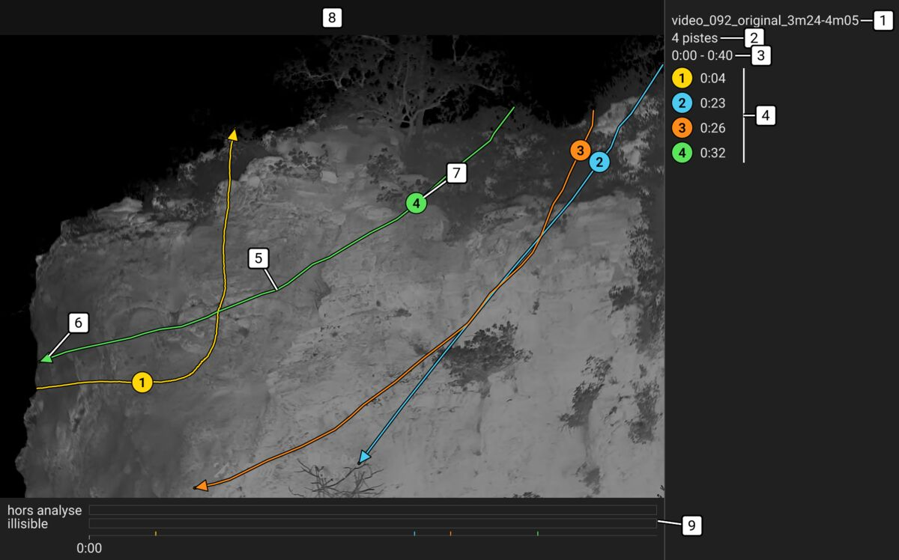
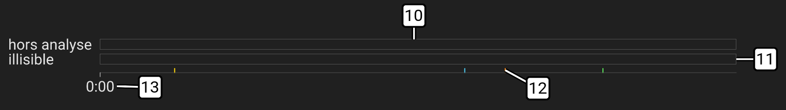
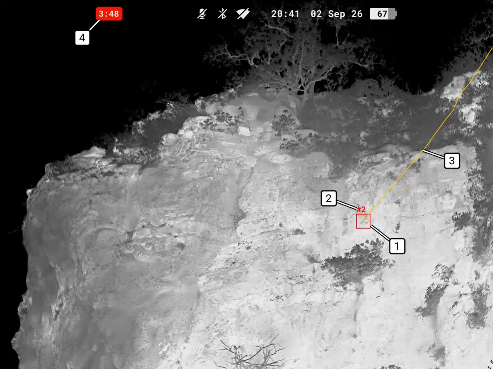
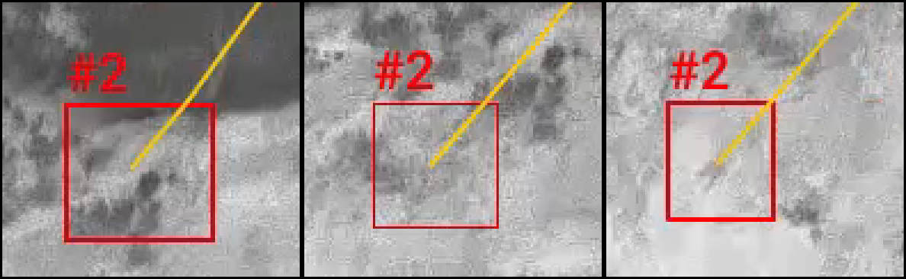
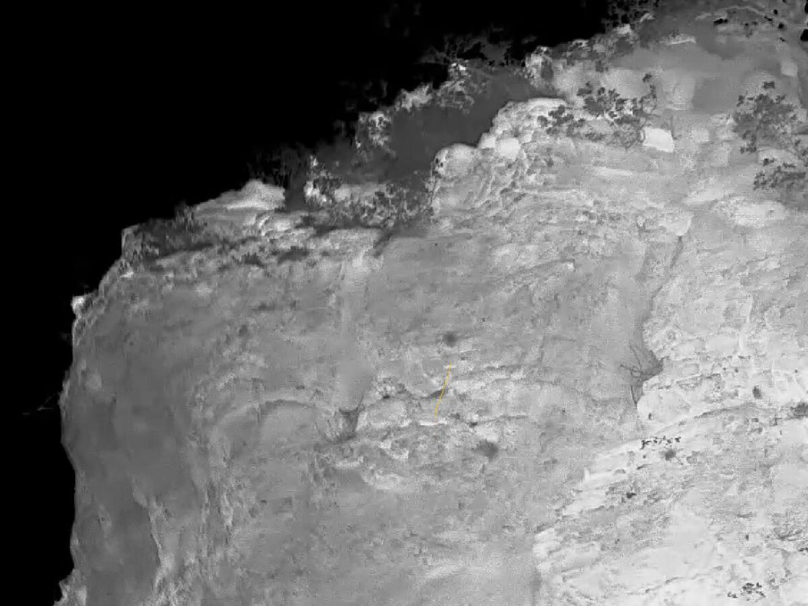
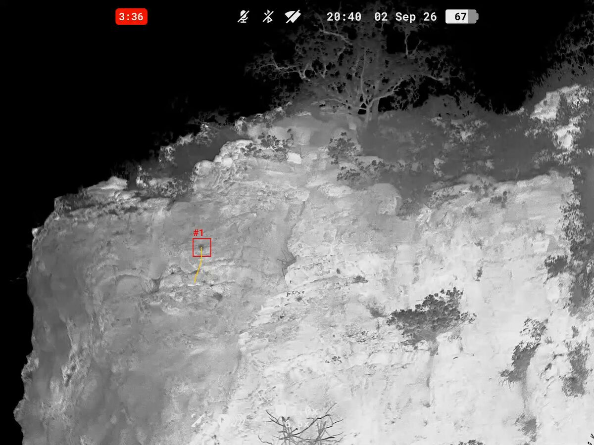

# Lire les résultats

Ce document aide à relire les résultats de `batdetect` : l'image résumé, le tableau des pistes et les extraits.
Les colonnes du tableau des pistes et quelques mots de la page sont définis dans le [glossaire](#glossaire).
La façon dont l'outil trouve les pistes est expliquée dans la [logique de détection](detection.md#méthode-globale).

L'outil ne sait pas reconnaître une chauve-souris : c'est vous qui tranchez à l'œil sur l'extrait.
D'où deux mots distincts. Une **piste** est ce que l'outil a trouvé : quelque chose qui s'est déplacé dans l'image.
Un **passage** est le vol d'une chauve-souris confirmé à l'œil sur l'extrait.
L'outil compte des pistes. Seuls les verdicts comptent des passages.

## Ce que l'outil ne voit pas

L'outil dit « quelque chose a bougé ici », jamais « c'est une chauve-souris ».
Depuis le verdict de Manon sur la 092 du 9 octobre 2026, ses réglages préfèrent une piste de trop à un passage manqué.
Une piste de trop s'écarte facilement à l'extrait.
La piste lente de 3:29 sur la 092 n'est pas une chauve-souris. L'outil la sort quand même : c'est voulu.
Il peut aussi manquer un passage, en couper un en deux ou en réunir deux.
Un nombre de pistes n'est donc pas un nombre de chauves-souris.
Une zone sans trajectoire n'est pas non plus une zone sans passage.

Le tableau part de ce que vous voyez puis dit ce qui a pu se passer et comment le vérifier.
Les liens entre guillemets mènent à l'étape en cause dans la [logique de détection](detection.md#méthode-globale).
Le numéro entre parenthèses mène au suivi du défaut. Une ligne sans numéro est une limite de principe.

| Ce que vous voyez | Ce qui a pu se passer | Quoi faire |
| --- | --- | --- |
| Une piste s'arrête net dans le ciel, ou une partie du ciel n'a aucune piste | Le ciel est d'une seule teinte uniforme, tout noir sur vos vidéos. Une chauve-souris sombre s'y confond, et rien ne signale cette zone ([« Un seuil propre à chaque endroit »](detection.md#seuiller-chaque-pixel)) | Revoir la vidéo d'origine là où la piste s'arrête, et ne pas lire ce ciel comme vide ([#9]) |
| Deux pistes qui se suivent, la seconde repartant là où la première s'arrête | L'outil ne recolle que les disparitions de moins d'une seconde, derrière un buisson par exemple, quand le vol reprend là où on l'attend. Ici, la chauve-souris a disparu plusieurs secondes, ou elle est sortie de l'image puis revenue, ou elle a beaucoup changé de direction pendant qu'elle était cachée, ou elle semble repartir presque sur place, bien plus lentement qu'elle ne volait ([« Le recollage »](detection.md#recoller-un-vol-caché-derrière-la-végétation)) | Regarder les deux extraits : si c'est le même animal, c'est un seul passage |
| Une piste qui commence au tout début ou finit à la toute fin d'un clip | Le vol continue dans le clip voisin, traité séparément. Et la scène sans animal y est estimée sur moins d'images : la détection y est moins sûre ([« La scène sans animal »](detection.md#estimer-le-fond)) | Ouvrir la fin du clip précédent ou le début du suivant : un vol à cheval sur deux clips est un seul passage ([#11]) |
| Un animal posé, en vol stationnaire, très lent ou qui tourne sur place, sans piste | Il s'est fondu dans le décor, ou son trajet n'a pas été reconnu comme un vol ([« La scène sans animal »](detection.md#estimer-le-fond), [« Ressembler à un vol »](detection.md#garder-ce-qui-ressemble-à-un-vol)) | Revoir la vidéo d'origine : l'outil voit mal ces animaux ([#22]) |
| Une cible faible, petite ou lointaine, ou qui passe devant de la végétation qui bouge, que vous suivez à l'œil, sans piste | Sur aucune image, ou sur trop peu, elle ne se détache assez du fond. Votre œil additionne plusieurs images, l'outil décide image par image ([« Le filtre à la taille de la cible »](detection.md#réduire-et-filtrer-limage), [« Un seuil propre à chaque endroit »](detection.md#seuiller-chaque-pixel), [« Les taches »](detection.md#regrouper-les-pixels-en-taches)) | Noter son temps et la compter vous-même : c'est un passage que l'outil a manqué ([#23]) |
| Dans l'extrait, la boîte passe en trait fin sur quelques images | La piste n'a pas de point sur ces images, même en comptant les taches faibles qui comblent un vol : la boîte y est à une position estimée ([« Le suivi image par image »](detection.md#relier-les-taches-dans-le-temps), [« Les taches faibles encadrées »](detection.md#garder-les-taches-faibles-qui-comblent-un-vol)) | Regarder l'extrait zoomé, s'il existe, ou la vidéo d'origine pour voir où est vraiment l'animal |
| L'animal est déjà visible dans l'extrait avant que la boîte n'apparaisse | La piste ne commence qu'une fois que la cible se détache assez du fond. Sur des vols de chasse fabriqués, ce retard dépasse parfois quelques images ([« Le suivi image par image »](detection.md#relier-les-taches-dans-le-temps)) | Regarder l'extrait depuis son tout début : la durée et la vitesse du tableau des pistes ne couvrent alors qu'une partie du vol ([#42]) |
| L'animal vole encore dans l'extrait après que la boîte a disparu | La piste finit à la dernière image où la cible se détache assez du fond. Sur des vols de chasse fabriqués, cette fin arrive parfois quelques images trop tôt ([« Le suivi image par image »](detection.md#relier-les-taches-dans-le-temps)) | Regarder l'extrait jusqu'à sa toute fin : la durée et la vitesse du tableau des pistes ne couvrent alors qu'une partie du vol ([#42]) |
| Une seule piste là où vous voyez deux animaux | Deux animaux restés tout près l'un de l'autre sont réunis en une piste. Cette règle n'a jamais été éprouvée sur deux vraies chauves-souris ([« La fusion des morceaux »](detection.md#fusionner-les-pistes-jumelles)) | Compter les animaux à l'œil dans l'extrait, et noter ce moment : il servira à éprouver l'outil ([#26]) |
| Une piste très lente au milieu de vols rapides | L'outil ne distingue pas un vol d'un déplacement lent : c'est le cas de la piste de 3:29 sur la 092 ([verdict](resultats-092.md#verdict-de-manon-9-octobre-2026), [« Ressembler à un vol »](detection.md#garder-ce-qui-ressemble-à-un-vol)) | Comparer sa vitesse dans le tableau des pistes, puis trancher à l'extrait ([#28]) |
| Une chauve-souris plus claire que le ciel derrière elle | L'outil cherche dans les deux sens, plus clair ou plus sombre, mais n'a jamais été essayé sur une vraie vidéo de ce genre ([« Un seuil propre à chaque endroit »](detection.md#seuiller-chaque-pixel)) | Revoir la vidéo d'origine, et garder la vidéo : elle servira à éprouver l'outil ([#27]) |
| Une période hors analyse ou illisible sur l'image résumé | Les jumelles ont bougé, la luminosité a sauté d'un coup, un essaim a rempli l'image, ou le fichier est abîmé : rien n'y a été cherché ([« Les périodes ignorées »](detection.md#écarter-les-images-où-les-jumelles-bougent)) | Revoir la vidéo d'origine aux moments donnés par le bandeau (les trois premiers de chaque sorte) et par la frise du temps sous l'image, qui les montre tous |
| Une piste sur une image visiblement abîmée (blocs, morceaux d'image décalés), hors des périodes illisibles | Le fichier a été réparé à la lecture sans que rien ne le signale, et l'image passe pour une vraie scène ([« Les périodes ignorées »](detection.md#écarter-les-images-illisibles)) | L'écarter à l'extrait |
| Un nombre de passages à la fin de la relecture | L'outil manque des passages, pour les raisons ci-dessus, et aucun comptage de référence ne dit encore dans quelle proportion | Le présenter comme un minimum, et ne pas le comparer tel quel à un comptage à l'œil ou à une autre soirée ([#25]) |

Les réglages des jumelles qui aident l'outil sont dans la [première soirée](premiere-soiree.md#1-avant-la-première-fois).

## La page des résultats

À la fin du calcul, la page des résultats s'ouvre dans le navigateur.
C'est le fichier `resultats.html`, dans le dossier `batdetect/` à côté des vidéos ou dans le dossier choisi au lancement.
Pour la rouvrir plus tard, double-cliquer dessus.
Elle marche sans internet.
Elle marche encore après une copie de tout le dossier `batdetect/` sur une clé ou sur un autre ordinateur.

De haut en bas, elle montre :

- Le total de la soirée : les vidéos, les vidéos réussies et le nombre de pistes.
  S'il y en a, il nomme aussi les vidéos qui ont trop de pistes, celles en échec, les entrées refusées, les inachevées, celles d'une ancienne version, celles en attente et celles pas encore traitées.
- Les entrées refusées au départ du dernier lancement, s'il y en a eu.
  Chaque vidéo, dossier ou fichier écarté avant le calcul y figure avec la raison et ce qu'il faut faire, comme dans le bilan.
  Rien n'a été fait pour elles : les corriger comme indiqué puis relancer batdetect.
  Le lancement suivant remplace ces lignes par les siennes. S'il n'a rien refusé, il les retire.
- Une section par vidéo avec la date du calcul.
  Les sections suivent l'ordre alphabétique des noms de leurs dossiers (majuscules d'abord).
  Les soirées précédentes rangées dans le même dossier y sont aussi.
  Les vidéos du dernier calcul sont dépliées et les autres repliées. Un clic sur le nom ouvre ou ferme la section.

En haut de la page, une barre reste visible quand on fait défiler.
Elle donne le décompte des verdicts de la soirée (oui, non, doute, à voir) et leur état.
Elle porte aussi les boutons « Télécharger les verdicts » et « Recharger un fichier de verdicts… » ([Noter le verdict](#noter-le-verdict)).

### Une vidéo dans la page

Chaque section montre l'image résumé et la liste des pistes. Son en-tête dit combien de pistes sont jugées.
Chaque ligne de la liste donne le numéro de la piste, dans la couleur de sa trajectoire sur l'image.
Elle donne ensuite son début, sa durée, son verdict et l'espèce notée.
Le verdict reste « à voir » tant qu'il n'est pas donné.
L'étiquette « Zoom » s'y ajoute quand l'extrait zoomé existe.
Partout dans la page, le début s'écrit comme dans le tableau des pistes (« 0:00:51 »).

Une vidéo sans extrait ni image résumé ne se juge pas dans la page. C'est le cas d'une vidéo à trop de pistes.
Ses pistes sont listées avec leur numéro, leur début et leur durée seulement. Elles ne comptent pas dans « à voir ».
Un verdict noté sur elles lors d'un calcul précédent n'y est pas montré.
Il compte pourtant dans le décompte du haut et reste dans le fichier de verdicts.

### L'image redessinée

La page redessine l'image elle-même à partir de la scène de la vidéo, sans aucune trace.
Elle y trace les trajectoires, les flèches et les pastilles numérotées aux places que l'outil a choisies pour l'image résumé.
Ses traits gardent la même épaisseur quelle que soit la taille de l'image.
Ses numéros sont écrits dans la police de l'ordinateur.
Elle peut donc différer très légèrement de l'image résumé.

- Au-dessus de l'image, une ligne donne l'intervalle montré, le nombre de pistes et les périodes hors analyse et illisibles.
  Elle dit « rien hors analyse, rien d'illisible » quand il n'y en a pas. Au-delà de trois périodes, elle dit « + 4 autres ».
  Le lien « Ouvrir l'image complète » ouvre l'image résumé avec son bandeau et sa frise.
  C'est le fichier à garder ou à envoyer.
- Sous l'image vient la frise du temps. Elle porte un trait par début de piste, de la couleur de sa pastille.
  Les pistes des autres parties de la tranche y sont en gris.
  La frise montre aussi les minutes et, quand il y en a, les bandes « hors analyse » et « illisible ».
  Le survol d'un trait donne la piste et son début.
- La légende du bandeau de l'image résumé n'est pas redessinée.
  La liste des pistes en tient lieu, avec leurs pastilles et leurs débuts.
- Une vidéo de plus de 10 min ou de plus de 20 pistes peut avoir plusieurs images résumé.
  Des onglets « Partie » les séparent et chaque onglet dit quelles pistes il montre.
- Une vidéo calculée par une version précédente de l'outil garde son image résumé, sans frise sous l'image.
  Relancer la même commande la refait avec l'image redessinée.

### Le lecteur

Un clic sur la ligne d'une piste ou sur son numéro ouvre le lecteur à la place de l'image.
L'extrait de la piste y passe en boucle et en grand, avec le verdict et l'espèce dessous.
À droite vient l'image en petit, avec toutes les trajectoires mais la seule pastille de la piste jugée.
Un clic sur elle ouvre l'image complète.
La liste est aussi à droite, avec la piste jugée en évidence.

Le lecteur s'ouvre aussi depuis l'image et la frise :

- Un clic sur une trajectoire de l'image ou sur sa pastille ouvre le lecteur sur cette piste.
  Au survol, elle ressort et les autres pâlissent.
  Quand deux trajectoires se touchent, le clic prend la plus proche. Un second clic au même endroit prend l'autre.
- Dans l'image en petit du lecteur, une trajectoire ressort aussi au survol. Un clic sur elle passe à cette piste.
  Ailleurs, le clic ouvre l'image complète.
- Un clic sur un début de piste de la frise ouvre le lecteur sur cette piste.
  Au survol, sa trajectoire ressort sur l'image.
  Quand deux débuts se touchent, le plus proche du pointeur l'emporte.
- Au clavier, la touche Tab mène aux pastilles de l'image, les flèches passent d'une piste à l'autre et Entrée ouvre le lecteur.
  En revenant à l'image, le clavier reprend sur la pastille de la piste jugée.

Des boutons choisissent les pistes montrées : « Toutes », « À voir », « Oui », « Non », « Doute », chacun avec son nombre.
Ils sont au-dessus de l'image, et au-dessus de l'image en petit pendant le jugement.
« Autre » s'y ajoute quand une piste est notée d'un autre mot.
Le choix vaut pour l'image, la frise et la liste de la vidéo.
La piste en cours de jugement reste toujours montrée.
Pendant le jugement, les flèches ‹ et › ne passent que par les pistes montrées.

Sur la grande image, chaque piste jugée porte un petit signe près de sa pastille : une coche verte pour oui, une croix rouge pour non, un point d'interrogation jaune pour doute.
Une piste notée d'un autre mot n'a pas de signe : la liste et le bouton « Autre » le disent.
Les pistes jugées « non » sont grisées sur l'image et pâlies dans la frise.
L'image en petit du lecteur n'a pas de signe. La piste regardée y ressort et les autres sont voilées.

Dans le lecteur :

- « Extrait » et « Zoom » choisissent la vidéo. « Image résumé » ferme le lecteur.
  ‹ et › passent à la piste précédente ou suivante. « À voir » saute à la prochaine piste sans verdict.
  Sur un écran étroit, l'étiquette « Zoom » de la liste laisse sa place au verdict pendant le jugement.
  Le bouton « Zoom » ou « pas de zoom » dit alors si la piste jugée en a un.
- Au clavier : `O` oui, `N` non, `D` (ou `?`) doute, `Suppr` efface le verdict.
  `E` va au champ espèce et `Z` passe de l'extrait au zoom.
  Les flèches ← et → changent de piste, Maj et → va à la prochaine piste à voir. Espace lit ou arrête.
  Un second appui sur le même verdict l'efface. Les lettres tapées dans le champ espèce restent du texte.
- « Enchaîner » est cochée d'origine.
  Après « Oui », le curseur va dans le champ espèce et Entrée passe à la piste suivante.
  Après « Non » ou « Doute », la page passe directement à la suivante.
  Décochée, rien ne bouge seul. On ne passe jamais d'une vidéo à l'autre.

### Vidéos en échec ou pas finies

Une vidéo en échec garde sa place dans la liste, marquée en rouge.
Comme dans le bilan, elle donne la raison et ce qu'il faut faire.
Si les résultats d'un calcul précédent sont encore là, un lien y mène.
Ce n'est pas toujours le cas : un nouveau calcul commence par les effacer.

| Mention | Ce qui s'est passé | Quoi faire |
| --- | --- | --- |
| « inachevée » | Le calcul s'est arrêté avant la fin de la vidéo | Relancer la même commande |
| « en attente » | Le calcul est en cours et n'a pas encore traité cette vidéo | Rien |
| « pas encore traitée » | Le calcul a été interrompu avant cette vidéo | Relancer la même commande |
| « ancienne version » | Une version plus ancienne de l'outil l'a calculée ; le total la nomme à part | Relancer la même commande |

Limite : les résultats d'une vidéo sont rangés sous son nom.
Deux soirées peuvent être envoyées dans le même dossier choisi au lancement avec des vidéos de même nom.
La seconde remplace alors la première et la page ne montre que la dernière.
Gardez un dossier par soirée.

## Où sont les résultats

Chaque vidéo a un dossier à son nom, dans `batdetect/` à côté des vidéos ou dans le dossier choisi au lancement (`-o`).
Les noms des fichiers sont en français sur un Mac réglé en français et en anglais sinon.
Les mots ajoutés par l'outil ne portent jamais d'accent.
Un nouveau calcul efface les fichiers de l'autre langue.

| Fichier | Français | Anglais |
| --- | --- | --- |
| Image résumé | `<vidéo>_resume.png` | `<vidéo>_summary.png` |
| Scène seule, sans trace, pour la page | `<vidéo>_fond.png` | `<vidéo>_background.png` |
| Tableau des pistes | `<vidéo>_pistes.csv` | `<vidéo>_tracks.csv` |
| Extrait | `extraits/piste_01_0m04s.mp4` | `clips/track_01_0m04s.mp4` |
| Extrait zoomé | `extraits/piste_01_0m04s_zoom.mp4` | `clips/track_01_0m04s_zoom.mp4` |
| Vidéo annotée | `<vidéo>_annotee.mp4` | `<vidéo>_annotated.mp4` |
| Réglages et bilan du calcul | `params.json` | `params.json` |

À côté de la page, `verdicts.csv` garde les verdicts de toute la page ([Noter le verdict](#noter-le-verdict)).
C'est la page qui le télécharge. L'outil le lit sans jamais l'écrire.

- Une vidéo de plus de 10 min a une image résumé par tranche de 10 min (`<vidéo>_resume_000m-010m.png`, …).
  Une image qui aurait plus de 20 pistes est coupée en parties (`<vidéo>_resume_1_sur_3.png`, …).
- Un extrait est nommé par le numéro de sa piste et son début à la seconde.
  Le numéro départage deux pistes de la même seconde.
  Il a deux chiffres, trois dès 100 pistes : le Finder range ainsi les extraits dans l'ordre.
  Par défaut, l'extrait zoomé n'existe que pour les pistes petites ou faibles ([Juger un extrait](#juger-un-extrait)).
- La vidéo annotée est la vidéo entière avec toutes les pistes dessinées. Elle n'est écrite qu'avec `--annotated`.
  Sans l'option, celle d'un calcul précédent est effacée.
  Une vidéo à [trop de pistes](#trop-de-pistes) n'a ni extraits ni image résumé, ni fond ni vidéo annotée.
- `params.json` s'écrit en dernier.
  Un dossier sans lui n'est pas terminé : le calcul a été interrompu, ou la vidéo est en échec pour une autre raison que trop de pistes.
  La vidéo est alors refaite à la relance.
- Le tableau français s'ouvre dans un tableur réglé en français (point-virgule, virgule décimale).
  Le tableau anglais s'ouvre dans un tableur réglé en anglais.
  Un tableur réglé en anglais affiche le début `0:00:04` comme `12:00:04 AM` : la valeur est juste (4 s).
  Un format Durée la montre en `0:00:04`.
- Deux vidéos peuvent avoir le même nom aux majuscules près et aller dans le même dossier de résultats.
  Elles ajoutent alors leur extension au nom de leur dossier : `video_092_mp4/` et `video_092_mov/`.
  Avec `-o`, elles y ajoutent aussi le nom de leur dossier d'origine : `nuit-12-oct_video_092_mp4/`.
  Deux vidéos qui tomberaient encore sur le même dossier sont refusées avant tout calcul. Il faut alors renommer l'une d'elles.
  La seconde peut arriver plus tard, comme `video_092.mov` à côté de `video_092.mp4`.
  Les deux sont alors recalculées dans leurs dossiers renommés.
  L'ancien dossier `video_092/` reste là, orphelin : il faut le supprimer à la main.
- À côté des dossiers des vidéos se trouve la [page des résultats](#la-page-des-résultats), `resultats.html` (`results.html` en anglais).
  Un dossier caché, `.batdetect/`, y garde la raison des vidéos en échec.
  La page en a besoin : les laisser avec les dossiers des vidéos.

Le bilan affiché à la fin du calcul et la reprise d'une soirée interrompue sont décrits dans la [première soirée](premiere-soiree.md#6-ouvrir-les-résultats).

## Lire l'image résumé

L'image résumé montre d'un coup d'œil toutes les pistes d'une vidéo sur la scène sans animal : où elles passent, dans quel sens, quand elles commencent et quels moments l'outil n'a pas regardés.
Elle sert à choisir les extraits à ouvrir. Elle ne dit pas ce qu'est une piste.

Les repères numérotés (carrés blancs) ont été ajoutés pour ce document : l'outil ne les dessine pas.

*L'extrait de test de la 092 (40 s, de 3:24 à 4:05) avec l'affichage des jumelles masqué : 4 pistes.*

### Le bandeau, à droite

1. **Le nom de la vidéo**, terminé par « ... » s'il est trop long.
2. **Le nombre de pistes de l'image.**
   Au-delà de 20 pistes dans une même tranche de 10 min, l'image est coupée en parties d'au plus 20 pistes.
   Une ligne `partie 1 / 3` s'ajoute alors entre le nom et ce nombre.
   Ce nombre devient celui de la partie.
3. **L'intervalle couvert**, compté depuis le début de la vidéo à la seconde inférieure.
   C'est la vidéo entière jusqu'à 10 min, sinon la tranche (`10:00 - 20:00`).
   Pour une partie, il va du début de sa première piste à la fin de la dernière à finir, arrondie au-dessus.
   Une piste à cheval sur deux tranches n'est dessinée que sur l'image de la tranche où elle commence : son trait peut dépasser l'intervalle.

   Viennent ensuite les périodes de la tranche où rien n'a été cherché, s'il y en a.
   Elles sont arrondies vers l'extérieur à la seconde et celles qui se touchent sont réunies.
   Chaque partie de la tranche les répète.
   On lit jusqu'à trois lignes `hors analyse 1:02 - 1:15` puis `+ 4 autres`.
   Suivent jusqu'à trois lignes `illisible 2:10 - 2:12` puis `+ 4 autres, 45 s illisibles en tout`.
   Cette durée compte toutes les périodes illisibles de la tranche.
   L'extrait n'en a aucune : ces lignes manquent sur la capture.
4. **La légende** : la pastille de chaque piste et son début à la seconde inférieure.
   Elle tient sur plusieurs colonnes s'il le faut.
   Le numéro est celui du tableau des pistes et du nom de l'extrait (`piste_01_0m04s.mp4`).
   Le début au centième est dans la colonne `début (s)` du tableau.

### L'image

5. **Le trait** : le trajet de la piste, qui relie ses points.
   Il est bordé de noir pour rester visible sur un fond clair.
6. **La flèche** au bout du trait marque la fin de la piste.
   Elle pointe dans le sens du vol à ce moment-là.
   Le départ est l'autre bout du trait, sans marque.
7. **La pastille** : le disque numéroté de la piste.
   Elle est posée vers le quart du trajet.
   Elle est ensuite glissée le long du trait pour s'écarter des autres pastilles, des pointes de flèche et des endroits où un autre trait passe tout près.
   Elle ne marque donc **pas le départ** : pour le trouver, suivre le trait à l'opposé de la flèche.

   Quand aucune place sur le trait n'évite une autre pastille, la pastille est décalée à côté.
   Si elle ne touche plus son trait, un **trait de rappel** de sa couleur la relie au point le plus proche de son trajet.
   Les quatre pastilles de l'extrait sont sur leur trait : il n'y a aucun trait de rappel.
8. **La zone masquée** par `--osd-region` : un gris très foncé uni, plus sombre que le bandeau.
   Il remplace l'affichage des jumelles (heure, date, batterie, chrono).
   Pour les Symbion : `--osd-region 0,0,1,0.07`.
   L'outil n'y cherche rien.
   Sans cette option, l'affichage reste visible dans le fond.
   Les inscriptions fixes que l'option ne couvre pas restent aussi.
   Ici, les grossissements « 2.0x » et « 6.5x » restent à peine visibles en bas de l'image.

Le fond est la scène sans animal de toute la vidéo.
Il est assombri pour que les traits ressortent.

### La frise du temps, sous l'image

9. **La frise** couvre toute la vidéo ou toute la tranche de 10 min, même sur une partie.

10. **La bande « hors analyse »** : un rectangle gris par période hors analyse.
    Elle les montre toutes, pas seulement les trois du bandeau.
    Chaque rectangle fait au moins 2 pixels de large, même pour un instant.
    Elle est vide sur l'extrait : aucune image n'y a été écartée.
11. **La bande « illisible »** : de même, un rectangle blanc cassé par période illisible. Elle est vide aussi sur l'extrait.
12. **Les départs des pistes** : un petit trait de la couleur de la piste au-dessus de l'axe, à son début.
    Sur une partie, les départs des autres parties de la même tranche y sont aussi en gris.
13. **La graduation** : les minutes, tous les 1, 2, 5 ou 10 min selon la place.
    L'extrait dure 40 s : la seule graduation est 0:00.

### La couleur ne veut rien dire

La couleur sert seulement à distinguer une piste de ses voisines sur la même image.
Il y en a 12. Chaque piste prend la couleur la moins présente parmi les traits proches déjà dessinés.
À égalité, elle prend la moins employée.
Les 12 premières pistes d'une image ont chacune la sienne. À partir de la 13ᵉ, une couleur revient sur une piste éloignée si possible.
Deux traits de même couleur sont donc deux pistes.
La même couleur sur deux images ne désigne pas non plus la même piste.
La couleur ne dit rien de l'animal, de sa vitesse ni de la confiance de l'outil.
Les extraits, les zooms et la vidéo annotée reprennent la couleur de chaque piste sur l'image résumé : sa boîte, son numéro et la trace de son vol sont de cette couleur.
Seul le numéro identifie une piste.

## Juger un extrait

L'image résumé dit où regarder. Le verdict se donne à l'œil, sur l'extrait.

### Regarder l'extrait, puis le zoom

Sauf dans une vidéo à [trop de pistes](#trop-de-pistes), chaque piste a son extrait `extraits/piste_01_0m04s.mp4`.
C'est la vidéo en pleine taille et à vitesse réelle.
Par défaut, il va de 1,5 s avant le début de la piste à 1,5 s après sa fin.
Il se regarde dans la [page des résultats](#la-page-des-résultats). Un lecteur vidéo permet aussi d'avancer image par image.
Le regarder d'abord en entier, puis image par image là où la cible passe.

Si la cible est petite ou faible, un second fichier l'accompagne : `piste_01_0m04s_zoom.mp4`.
C'est la même scène recadrée autour du trajet, agrandie jusqu'à quatre fois et ralentie quatre fois.
Par défaut, il n'existe que pour les pistes dont la plus grande tache fait moins de 100 px ou dont l'amplitude est sous 40.
Une piste recollée après un passage derrière la végétation a son zoom si l'une de ses parties seule l'aurait eu.
La partie nette ne fait pas perdre le zoom à la partie faible.
`--zoom all` en fait un pour chaque piste et `--zoom none` aucun ([détection](detection.md#extrait-zoomé-et-ralenti)).

Regarder le zoom après l'extrait normal.
C'est de là qu'il vient : une cible de 3:42 sur la 092 avait été jugée fausse à vitesse normale.
Une fois agrandie et ralentie dans un lecteur, elle s'est révélée un objet réel.

### Ce que l'extrait dessine

*Extrait de la piste 2 de l'extrait de test (0:00:23) à 1,9 s du début de l'extrait : une chauve-souris qui descend de droite à gauche.*

1. **La boîte** entoure la cible, par défaut avec une marge de 12 pixels de chaque côté.
   Elle a la couleur de la piste sur l'image résumé.
   Un liseré noir la détache de la roche claire comme du ciel sombre.
2. **Le numéro** `#2` est écrit au-dessus de la boîte, de la même couleur.
   C'est celui de la piste dans le tableau, dans la légende de l'image résumé et dans le nom du fichier.
3. **La trace** a la même couleur. Elle suit le trajet de la dernière seconde (par défaut) jusqu'à la cible.
   Pour un vol rapide comme celui-ci, elle montre presque tout le passage.
4. **L'affichage des jumelles** (chrono d'enregistrement en rouge, heure, date, batterie) reste tel qu'il a été filmé : ce rouge-là ne vient pas de l'outil.

Les autres pistes présentes au même moment sont dessinées aussi, chacune avec sa boîte, son numéro et sa trace.
Les réglages du dessin sont dans [détection](detection.md#dessiner-les-extraits).

*Trois images successives du même extrait vers 1,8 s, agrandies trois fois.*

**Boîte épaisse ou fine.**
La boîte est épaisse (2 pixels) sur une image où l'outil a vu la cible.
Elle est fine (1 pixel) sur une image où il ne l'a pas vue.
Sur ces images, sa place est estimée entre les deux images les plus proches où l'outil a vu la cible.
L'animal peut ne pas y être tout à fait.
L'image du milieu en est une. Le tableau des pistes en donne le nombre par piste (`images comblées`).

*Zoom de la piste 1 (0:00:04) au même moment, à 8,3 s du début de l'extrait normal.
Il est produit avec `--zoom all` : cette piste est assez grande et contrastée pour ne pas en avoir par défaut.
Son trajet couvre une grande partie de l'image : il n'est agrandi ici qu'environ ×1,6.*

**Sur le zoom**, seule la trace est dessinée, en trait fin et de la couleur de la piste.
Il n'y a ni boîte ni numéro ni autres pistes, pour ne rien cacher d'une cible ténue.
La trace s'arrête un peu avant la cible. Le cadre ne bouge pas pendant tout le zoom.

### Désigner une piste

Le numéro d'une piste change quand un réglage ou une nouvelle version ajoute ou retire une piste plus tôt dans la vidéo.
Pour parler d'une piste dans une note ou un message, donner **la vidéo, le début et le numéro** : « video_092_original_3m24-4m05, 0:00:04, piste 1 ».
Le début est celui de la colonne `début` du tableau des pistes.
Le numéro départage deux pistes qui commencent dans la même seconde.

### Noter le verdict

Le verdict se note piste par piste dans le lecteur de la page : « Oui », « Non » ou « Doute ».
L'espèce s'y note en texte libre. La page propose les espèces déjà tapées.
L'outil ne tient jamais compte de ce qui y est noté : les verdicts servent à compter les passages.

La page ne peut pas écrire sur le disque.
Elle garde les verdicts dans un fichier `verdicts.csv`, qu'on télécharge par « Télécharger les verdicts ».
Le fichier arrive dans Téléchargements, peut-être sous le nom `verdicts (1).csv` ou `verdicts-2.csv` si le navigateur en a déjà un.
Le glisser dans le dossier de la page, à côté de `resultats.html`.
S'il y en a plusieurs, la page lit le plus récent et dit lequel.
Le fichier couvre toutes les vidéos de la page et s'ouvre dans un tableur pour compter.
Il a une ligne par piste jugée, avec la vidéo, le numéro, le début, le verdict et l'espèce.

Tant que le fichier n'est pas téléchargé, la barre le dit : « Changements non téléchargés ».
Le navigateur demande alors confirmation avant de quitter la page.
Il garde aussi les verdicts non téléchargés. En rouvrant la page, on les retrouve et la page le signale.
« Recharger un fichier de verdicts… » relit un fichier choisi, par exemple celui resté dans Téléchargements.

Un nouveau calcul ne touche jamais au fichier de verdicts.
Chaque verdict retrouve sa piste par son début (à un cinquième de seconde près) et son point de départ sur l'image, même si les numéros ont changé.
Un verdict dont la piste n'existe plus reste dans le fichier.
La page le montre au-dessus de la liste de sa vidéo, sous « Verdicts sans piste ».
Elle indique la piste la plus proche, à vérifier sur l'extrait.
Quand la vidéo n'a pas d'extrait, la vérification se fait dans la vidéo elle-même.
Le tableau des pistes `<vidéo>_pistes.csv` appartient à l'outil. Un recalcul le remplace et ce qu'on y aurait écrit est perdu.

### Les faux positifs déjà vus

Les cas ci-dessous ont été vus à la relecture de vraies vidéos. Chacun renvoie à l'endroit où il est décrit.
Manon doit encore relire cette liste.

| Ce que vous voyez | Où ça a été vu | Source |
| --- | --- | --- |
| Un objet qui se déplace lentement et régulièrement, sur plusieurs secondes | La piste de 3:29 sur la 092, que Manon a écartée. C'est la piste 1 de l'extrait de test (0:00:04, 95 px/s, contre 1 383 à 1 926 px/s pour les trois chauves-souris) : voir l'image ci-dessous | [résultats de la 092](resultats-092.md#verdict-de-manon-9-octobre-2026) |
| Une piste courte qui change de direction au hasard, sur une vidéo au grain fort | Le scintillement de pixels isolés, que le suivi enchaîne en pistes. Sur la 089, deux filtres le visent et écartent 92 de ses 96 pistes | [détection](detection.md#garder-ce-qui-ressemble-à-un-vol) |
| Une piste sur une image abîmée (blocs, morceaux d'image décalés) | Sur la 122 : 4 pistes collées aux plages illisibles, que la marge laissée autour des images abîmées écarte | [détection](detection.md#écarter-les-images-illisibles), [Ce que l'outil ne voit pas](#ce-que-loutil-ne-voit-pas) |
| Une piste avec un trou, qui repart ailleurs : peut-être deux animaux | Pas encore vu sur une vraie vidéo. Possible quand deux animaux se suivent de près, au même endroit et à la même vitesse : l'outil ne sépare que ceux dont la seconde piste repart presque là où la première s'est arrêtée | [détection](detection.md#recoller-un-vol-caché-derrière-la-végétation) |

D'autres cas sont possibles, mais aucun n'a encore été relevé sur ces vidéos : un insecte, un oiseau ou une feuille agitée par le vent.
Sur une feuille, un pixel passe encore parfois le seuil ([détection](detection.md#seuiller-chaque-pixel)).

*Extrait de la piste 1 de l'extrait de test (0:00:04) à 8,3 s du début de l'extrait : la piste lente, qui n'est pas une chauve-souris.
La trace d'une seconde y est courte : l'objet avance peu.*

## Glossaire

Ces mots apparaissent dans le tableau des pistes, la page ou le Terminal.

### Amplitude

Colonne `amplitude (niveaux de gris)` du tableau des pistes.
C'est le plus fort écart entre la piste et la scène sans animal.
Il se mesure sur l'image filtrée par l'outil et non sur l'image brute ([détection](detection.md#seuiller-chaque-pixel)).
Plus l'amplitude est faible, plus la cible se voit mal à l'œil.

### Corde

Colonne `corde (px)` du tableau des pistes.
C'est la distance en ligne droite entre le début et la fin de la piste, en pixels de la vidéo d'origine.
Une piste longue à petite corde a tourné ou est revenue sur ses pas.

### Images comblées

Colonne `images comblées` du tableau des pistes.
Ce sont les images d'une piste sans point, entre deux points.
La boîte de l'extrait y passe en trait fin à une position estimée pour ne pas clignoter.

### Période hors analyse

Un moment où l'image se remplit soudain de taches.
Le plus souvent, les jumelles ont bougé.
L'outil ignore ces images et leurs abords ([détection](detection.md#écarter-les-images-où-les-jumelles-bougent)).
Rien n'y a été cherché : ces moments sont à revoir à l'œil.
Le bandeau de l'image résumé donne le début et la fin des trois premiers.
La frise du temps les montre tous.

### Période illisible

Un moment où le fichier vidéo est abîmé, avec des images manquantes ou réparées à la lecture.
L'outil l'ignore avec une marge de chaque côté ([détection](detection.md#écarter-les-images-illisibles)).
Comme pour une période hors analyse, rien n'y a été cherché.
Le bandeau donne les trois premières, puis le nombre des autres et la durée illisible en tout.
La frise du temps les montre toutes.

### Point

Colonne `points` du tableau des pistes : le nombre d'images où l'outil a vu la cible.
Un point est la tache retenue pour la piste sur une image.
Une tache est un groupe de pixels voisins qui se détachent du fond ([détection](detection.md#regrouper-les-pixels-en-taches)).
Entre deux points, la boîte de l'extrait suit la piste sur des [images comblées](#images-comblées).

### Surface

Colonne `surface max (px)` du tableau des pistes.
C'est la surface de la plus grande tache de la piste, en pixels de la vidéo d'origine.
Elle dépend de la distance et du contraste de l'animal autant que de sa taille.
Une piste peut être cachée en cours de vol, derrière la végétation par exemple.
Elle garde son extrait zoomé si une de ses parties est petite ou pâle, même quand cette colonne montre une grande tache.

### Trop de pistes

Mention du bilan dans le Terminal et de la page.
Au-delà d'un certain nombre de pistes, elles sont presque sûrement du bruit d'image.
L'outil écrit alors le tableau des pistes mais ni extraits ni image résumé.
Pour en juger, ouvrir le tableau et regarder la vidéo à quelques-uns des débuts qu'il donne.
Si ce sont de vrais passages, relancer avec un `--max-tracks` plus grand.
Les autres vidéos du lot sont traitées normalement.

### Vitesse

Colonne `vitesse (px/s)` du tableau des pistes.
C'est le chemin parcouru par la piste divisé par sa durée, en pixels par seconde dans l'image.
Ce n'est pas une vitesse en mètres par seconde : la distance entre l'animal et les jumelles est inconnue.

[#9]: https://github.com/zaratan/chiro-dvr/issues/9
[#11]: https://github.com/zaratan/chiro-dvr/issues/11
[#22]: https://github.com/zaratan/chiro-dvr/issues/22
[#23]: https://github.com/zaratan/chiro-dvr/issues/23
[#25]: https://github.com/zaratan/chiro-dvr/issues/25
[#26]: https://github.com/zaratan/chiro-dvr/issues/26
[#27]: https://github.com/zaratan/chiro-dvr/issues/27
[#28]: https://github.com/zaratan/chiro-dvr/issues/28
[#42]: https://github.com/zaratan/chiro-dvr/issues/42
