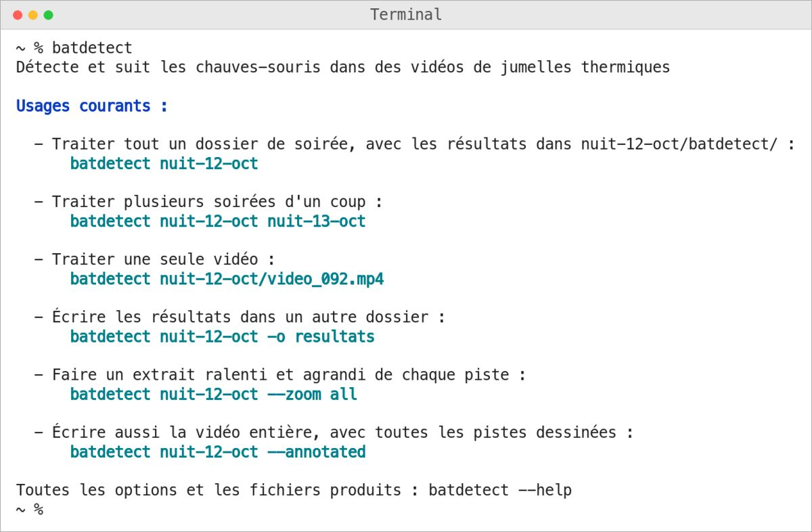
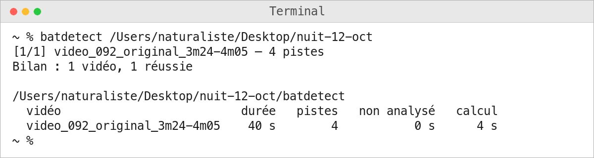

# Première soirée : des jumelles aux résultats

Ce guide suit une soirée d'enregistrement, des jumelles jusqu'aux pistes à regarder, sur un
Mac. Chaque étape dit ce qu'on fait et ce qu'on doit voir. Les exemples prennent une soirée
rangée dans un dossier `nuit-12-oct`, comme l'aide de la commande.

## 1. Avant la première fois

**Vérifier le Mac.** Menu Pomme › À propos de ce Mac : la ligne « Puce » doit nommer une puce
Apple (M1, M2…), et la version de macOS doit être 14 ou plus récente.

**Ouvrir le Terminal**, l'application où l'on tape les commandes : Cmd + Espace, taper
`Terminal`, puis Entrée.

**Installer Homebrew**, qui installe ensuite l'outil : copier la commande affichée en tête du
site [brew.sh](https://brew.sh) dans le Terminal, puis Entrée. L'installeur demande le mot de passe du
Mac (rien ne s'affiche pendant la frappe, c'est normal) et peut prendre plusieurs minutes. Il
finit par « Next steps » : copier et lancer, une par une, les commandes qu'il affiche là, sans
quoi le Terminal ne trouve pas `brew`.

**Installer l'outil** : taper `brew install zaratan/bat-tools/batdetect`, puis Entrée. Pour
vérifier, taper `batdetect --version` : la première ligne affichée doit dire
« batdetect 0.2.0 ». Tout cela ne se fait qu'une fois.

## 2. Brancher les jumelles

Brancher les jumelles **allumées** au Mac par leur câble USB-C. Sur les jumelles, choisir le
mode **« Accès aux fichiers »** avec la bague, puis valider par MENU. Les jumelles apparaissent
dans le Finder comme une clé USB
([Contexte : récupérer les vidéos](01-contexte.md#récupérer-les-vidéos-originales)).

## 3. Copier les vidéos

Créer un dossier pour la soirée sur le Mac, par exemple `nuit-12-oct` sur le Bureau, et y
copier les vidéos de la soirée avec le Finder, par glisser-déposer depuis les jumelles.

- **Jamais par l'application Stream Vision 2** : son export réencode les vidéos et divise leur
  débit par 12 environ. Sur une vidéo d'essai, l'export a fait perdre 2 des 14 pistes, deux
  chauves-souris que la copie d'origine montre.
- **Jamais directement sur les jumelles** : ne pas lancer l'outil sur leur volume. Les résultats
  s'écriraient sur leur carte ; on travaille toujours sur la copie du Mac.

Les vidéos doivent être directement dans le dossier : l'outil ne lit que son premier niveau, pas
les sous-dossiers. Il prend les fichiers `.mp4`, `.mov`, `.avi`, `.mkv` et `.m4v` ; les autres
fichiers du dossier, photos ou notes, sont laissés de côté sans rien dire.

**Prévoir de la place pour les résultats.** Ils s'écrivent à côté des vidéos, sur le même disque, sauf si un autre dossier est choisi. Une soirée calme laisse des résultats plus légers que ses vidéos ; une soirée très active peut en demander jusqu'à sept fois leur taille, et la vidéo annotée près de trois fois de plus.

## 4. Lancer

Dans le Terminal, **taper `batdetect` suivi d'une espace, puis glisser le dossier de la soirée**
depuis le Finder dans la fenêtre du Terminal : son chemin s'écrit tout seul, par exemple
`/Users/naturaliste/Desktop/nuit-12-oct` (le Bureau s'y écrit « Desktop »). Appuyer sur Entrée.

`batdetect` tapé seul, sans dossier, rappelle les usages courants :

Le Terminal s'ouvre dans votre dossier personnel, pas sur le Bureau : un nom de dossier tapé à
la main y est cherché, n'est pas trouvé, et rien n'est traité :

> erreur : aucune vidéo n'est traitée :\
> nuit-12-oct : introuvable\
> à faire : vérifier le chemin nuit-12-oct ; le dossier ou la vidéo a peut-être été déplacé ou renommé

Glisser le dossier évite cette erreur.

**La première fois, macOS peut demander** si le Terminal a le droit d'accéder au dossier :
autoriser. Si l'accès a été refusé, rien n'est traité :

> erreur : aucune vidéo n'est traitée :\
> nuit-12-oct : lecture refusée\
> à faire : vérifier les droits de /Users/naturaliste/Desktop/nuit-12-oct ; sur Mac, autoriser le Terminal dans Réglages Système, Confidentialité et sécurité, Fichiers et dossiers

Il faut alors ouvrir Réglages Système › Confidentialité et sécurité › Fichiers et dossiers,
autoriser le Terminal pour ce dossier (le Bureau, par exemple), puis relancer.

**Avant de calculer, l'outil ouvre chaque vidéo.** Une vidéo qui ne peut pas être lue, ou dont la copie est ratée, est refusée tout de suite, avec ce qu'il faut faire, au lieu d'échouer au milieu de la soirée :

> erreur : aucune vidéo n'est traitée :\
> video_093.mp4 : ce fichier n'est pas une vidéo lisible, ou sa copie est incomplète\
> à faire : s'il vient des jumelles, le recopier par le câble USB, sans passer par Stream Vision 2 ; sinon, le retirer du dossier

**Avec plusieurs dossiers d'un coup**, ou quand une seule vidéo est refusée parmi d'autres, la commande nomme l'entrée refusée (introuvable, illisible…) et demande s'il faut traiter quand même les autres. Entrée ou `o` lance le calcul, `n` l'arrête ; toute autre réponse repose la question :

> erreur : une entrée est refusée :\
> nuit-13-oct : introuvable\
> à faire : vérifier le chemin /Users/naturaliste/Desktop/nuit-13-oct ; le dossier ou la vidéo a peut-être été déplacé ou renommé\
> Traiter quand même la vidéo valide ? (O/n)

**Si le disque des résultats semble trop petit**, l'outil le dit avant de calculer, en nommant le dossier de résultats qui s'y trouve, et demande s'il faut lancer quand même :

> erreur : le disque des résultats semble trop petit :\
> le disque qui contient nuit-12-oct/batdetect : 6,4 Go à prévoir, 4,1 Go libres\
> à faire : libérer de la place, ou écrire les résultats sur un autre disque avec -o ; --ignore-disk lance quand même le calcul\
> Traiter quand même les 12 vidéos valides ? (O/n)

Répondre `o` lance la soirée. Chaque vidéo vérifie encore la place avant d'écrire ses extraits : s'il en manque, elle s'arrête et compte en échec, au lieu de remplir le disque, et la vidéo suivante est tentée.

## 5. Attendre

Le calcul commence par une ligne qui annonce la soirée, par exemple « 12 vidéos, 1 h 2 min 5 s de vidéo ». Quand la même commande est relancée, elle dit aussi combien sont déjà faites : « 12 vidéos, 1 h 2 min 5 s de vidéo, dont 3 déjà faites ».

Pendant le calcul, une seule ligne se redessine sur place : le rang de la vidéo dans le lot, son
nom, puis l'étape en cours, par exemple « [1/1] video_092_original_3m24-4m05 — détection »,
puis `suivi`, `image résumé` et `extraits`. À la fin de chaque vidéo, sa ligne reste à l'écran
avec son nombre de pistes. Puis vient le bilan de la soirée :

Le bilan donne, pour chaque vidéo, sa durée, son nombre de pistes, le temps non analysé et le
temps de calcul. Les vidéos en échec viennent ensuite, chacune avec ce qu'il faut faire.

Sur le Mac du développeur (M1 Max), il faut environ 20 s par vidéo de 5 min, soit à peu près
4 min par heure d'enregistrement. Sur un Mac plus modeste, c'est plus long ; ce temps n'y a pas
encore été mesuré ([Questions ouvertes](06-questions-ouvertes.md)).

Une fois la première vidéo calculée, la ligne qui se redessine donne aussi l'heure à laquelle toute la soirée devrait être traitée, par exemple « [3/12] video_094 — détection · fin vers 22:41 ». Cette heure se calcule sur le temps qu'ont pris les vidéos déjà calculées pendant ce lancement et se corrige à chaque étape : c'est une estimation, et une vidéo avec beaucoup de pistes, qui a plus d'extraits à écrire, prend plus longtemps que les autres.

## 6. Ouvrir les résultats

À la fin du lot, une notification l'annonce et la page des résultats de chaque soirée s'ouvre
dans le navigateur : toutes les vidéos de la soirée, leur image résumé et leurs extraits, à
regarder sans quitter la page ([La page des résultats](lire-les-resultats.md#la-page-des-résultats)).
Pour s'en passer, ajouter `--no-notify` à la fin de la commande, après le dossier.

La page, `resultats.html`, est dans le dossier `batdetect/`, à côté des vidéos. Pour la rouvrir
plus tard, double-cliquer dessus. À côté d'elle, un dossier par vidéo : l'image résumé, le
tableau des pistes et les extraits. Leurs noms suivent la langue du Mac
([Où sont les résultats](lire-les-resultats.md#où-sont-les-résultats)).

Relancer la même commande sur le même dossier saute les vidéos déjà traitées, et les compte
« déjà faites » dans le bilan : un lot interrompu reprend là où il s'était arrêté. Une vidéo est
refaite si elle a changé, ou si les réglages, la version de l'outil ou la langue du Mac ne sont
plus les mêmes. `--force` refait tout.

Pour lire l'image résumé, juger un extrait et noter son verdict :
[Lire les résultats](lire-les-resultats.md).
